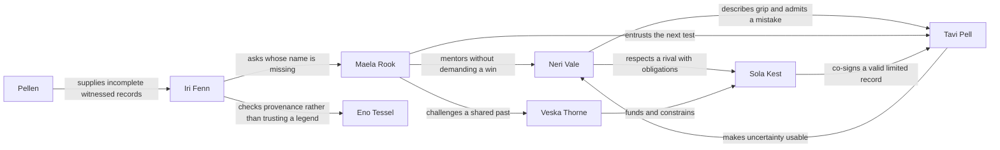
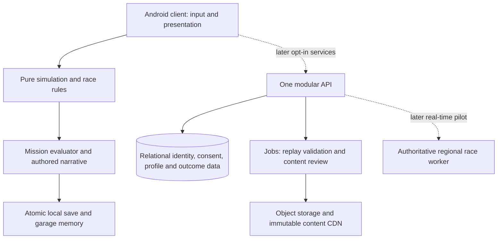

# Build VelocityVerse through the Openline crew

**Project Apex universe and product bible · 9 November 2026 · Strategy version 1.0**

Build a focused Android motorsport adventure in which **a real driving attempt becomes evidence, the evidence changes a crew decision, and the garage remembers the choice**. Keep **VelocityVerse** as the working franchise name and make **The Openline** its first season. The central question is human: can you become exceptional without leaving your people behind? Four characters, one community garage and one believable racing problem should prove that promise before a platform, ten cities or a creator economy consume the budget. This bible develops the requested universe, cast, systems, interfaces, competition, architecture, economics and expansion strategy; it **does not implement those proposed game features**. The existing Android 0.5 app is a useful offline driving prototype, with a physical phone installation in the project history, but no character campaign, multiplayer, public creator service or sustained production-performance proof. Current competitor facts are linked to primary sources; creative material, commercial scenarios and validation targets are explicitly proposals. The evidence supports a disciplined product experiment, not a claim that this is already an industry-leading game or a billion-dollar company.

The strongest launch proposition is **“Your best lap matters to someone.”** The first complete experience is **Light the Beacon**: help Neri, Tavi, Maela and Sola produce a credible test, complete a clean homologation run and reopen a workshop teaching room. A small visible consequence gives a player a reason to care about the next lap. More spectacle should strengthen that relationship rather than obscure controls, reading or performance.

All franchise, character, team and location names below are uncleared working candidates. All fictional geography and future mechanics are preproduction designs. Research date is 9 November 2026; platform terms and laws must be rechecked at an actual launch.

| Read this part | Decision it supports |
|---|---|
| [1. Identity, characters and world](#1-an-open-engineering-archive-gives-racing-human-stakes) | What the universe means, who audiences follow and where stories happen |
| [2. Gameplay and Android experience](#2-one-measured-run-connects-the-gameplay-universe) | Which systems connect, which mechanics to test and how the app feels |
| [3. Competition, architecture and AI](#3-compete-through-integration-and-build-in-stages) | What is established, what to differentiate and what technology to fund |
| [4. Business, safety and rights](#4-fund-a-trusted-game-before-a-global-franchise) | Who pays, what the economics require and what launch gates protect users |
| [5. First playable, roadmap and founder decisions](#5-prove-one-complete-crew-story-before-expanding) | What to build first, how to judge it and when to expand or stop |
| [Coverage index](#brief-coverage-and-implementation-status) | Where all thirteen requested parts are answered |

*Proposed preproduction key art. This is an illustrative concept, not gameplay or final character-model proof. See the [generation prompt and provenance](../research_notes/Project%20Apex%20universe%20strategy/openline-key-art-provenance.md). Human art direction, representation review and rights clearance remain required.*

## 1. An open engineering archive gives racing human stakes

### Identity and central mythology

VelocityVerse is the umbrella; *The Openline* is a season/subtitle rather than a second app or fictitious launch announcement. Player-facing promise: **Make your mark. Leave the line open.** A brand mark could be two offset lane segments with a deliberate gap, representing both a racing line and room for another person. Avoid checkered-flag clutter, superhero crests, official motorsport marks and copied red Formula-style typography. This is a direction to prototype, not a cleared logo.

**Setting.** A chain of technologically uneven cities shares a voluntary engineering archive called the Openline. Its records describe how people measured, repaired and improved things, including racing cars and closed circuits. A record is useful because it includes uncertainties and failures. Its old agreement allowed a small workshop to learn from a large team's work without pretending all inventions belong to everyone. Licences, safety certification and attribution still matter.

The most prestigious championship operator, **Crownline**, wants exclusive commercial control over the archive's competition-standard data. Its argument is credible: it finances marshals, insurance, accessibility and inspection, while open records can be copied incorrectly. Openline crews argue that accountable public access is possible without enclosing the archive. Neither side is universally right. The antagonism is about trust and control, not defeating an evil corporation by driving faster.

**Central mythology.** Forty-one years earlier, city engineers agreed to publish nine shared measurement standards after incompatible timing systems produced a disputed championship and concealed an unsafe test. Eight standards survive. The **Ninth Measure** was not a secret energy source: it was an agreement to preserve the provenance of a measurement, including who could challenge it. Different cities remember the dispute differently. The mystery therefore creates reasons to meet people and test evidence; it never invalidates physics or grants a combat power.

**Genre and tone.** Energetic, optimistic engineering adventure with genuine rivalry, warm failure and occasional melancholy. The visual world is aspirational and inhabited: repair stitches, personal charms, accessible ramps, old event tickets, heat-marked tools, working crowd routes and places to sit. Racing occurs at closed venues with marshals and safety rules. Teen characters can compete in a fictional licensed category; the fiction does not teach dangerous road behavior. Loss can cost a trophy or require a new approach, never a purchased life or a relationship that dies because the player missed a day.

**Distinctive emotional loop.** Race → interpret one understandable trace → choose whose contribution to credit or which repair to prioritize → see a bounded change in the crew's place. The player can point to the school bench they helped open and remember who made it. A race result, a relationship scene and a garage object share one causal history. This is a meaningful combination to test, not proof that no game has connected sports, story and building before.

**Four anchors.** Neri wants a future; Tavi wants to be certain; Maela wants to deserve trust; Sola wants to choose her own loyalty. Their first story works even if a player never learns the wider world's proper nouns. The opening should contain four characters, one place, one practical problem and one race objective. Other characters enter only when they change something the player can do or understand.

### Translate the inspirations into player value

The following are design interpretations of the brief's references, not empirical claims that a particular formula caused another franchise's success. Each translation must be tested in this product.

| Inspiration in the brief | Useful underlying design principle | VelocityVerse translation | Trap to reject |
|---|---|---|---|
| Marvel and Star Wars | Relationships and history make later encounters meaningful | A rival co-signs a test, a mentor corrects her own story and later chapters remember it | Superhero copies, compulsory lore homework or endless escalation |
| Disney | A coherent emotional language can travel across media | Every adaptation returns to contribution, honesty and belonging through the same cast | Launching a media portfolio before one story is loved |
| Pokémon | Distinct identities and repeatable interactions support attachment | Recognizable silhouettes, gestures, tools and remembered crew moments | Collecting eighteen interchangeable portraits or randomized affection |
| Roblox and Minecraft | Agency and visible authorship give players a place of their own | Bounded challenge kits and a garage whose earned exhibits have provenance | Rebuilding a general-purpose platform or exposing children to unreviewed content |
| Fortnite | Shared anticipation and new social occasions can renew interest | Small archived crew events with fair participation windows | Fear of missing out or fake global counters |
| GTA and Forza Horizon | A place feels alive through activity and spatial identity | An inhabited harbor garage, workers, transit, repairs and circuit landmarks | A huge empty map or dangerous public-road behavior |
| Duolingo | Clear next steps and feedback can build perceived competence | Predict, test, explain and transfer a principle at one's chosen pace | Streak loss, guilt or confusing lesson completion with learning |
| Formula 1 and motorsport | Constraints make engineering and teamwork consequential | One comparable car, readable tradeoffs, crew roles and accountable race rules | Depending on licensed sport branding or selling faster cars |

### Eighteen original character profiles

The four anchors receive production priority. The other fourteen are bible-level roles for later stories, not a commitment to eighteen playable campaigns. The player is a customizable recruit alongside this cast; choosing a guide changes perspective and explanations, not vehicle statistics. Each profile includes all twelve requested design fields.

### 1. Neri Vale — the first anchor / seventeen / she

1. **Name:** Neri Vale; no superhero alias. 2. **Silhouette:** compact forward-leaning stance, a broad soft collar, one triangular hip pouch and a short crescent-shaped ponytail; recognisable in a black thumbnail without a helmet. 3. **Personality:** quick improviser, dry humor, generous with practical help and terrible at waiting. 4. **Origin:** grew up above Lumen Harbor's community garage; her mother runs a ferry maintenance crew. She learned to notice vibrations before she understood equations. 5. **Ambition:** earn a legitimate test-driver place without the garage becoming her sponsor's showroom. 6. **Conflict:** mistakes action for usefulness and assumes asking for help makes her replaceable. 7. **Expertise:** describes subtle braking and grip changes in vivid ordinary language; she cannot calculate a complete setup. 8. **Identity:** deep teal suit with a coral collar fold, pale ceramic helmet carrying two off-center ventilation slots. 9. **Relationships:** Tavi's closest collaborator; Maela's impatient pupil; Sola's inconvenient admirer. 10. **Arc:** from proving she is fastest to giving others the evidence and space to contribute. 11. **Universe connection:** her garage holds the oldest surviving Harbor Openline terminal, not a hereditary magical destiny. 12. **Animation/merchandise:** expressive hands and a folding collar translate into animation; articulated figure, helmet and a reusable tool pouch provide objects with story meaning.

### 2. Tavi Pell — the first anchor / nineteen / they

1. **Name:** Tavi Pell. 2. **Silhouette:** tall, narrow, soft rectangular hair, a split work apron that folds into two stiff leaf-shaped pockets; hands often frame imaginary dimensions. 3. **Personality:** observant, precise and unexpectedly playful when turning a complicated idea into a small model. 4. **Origin:** moved from reservoir maintenance at Plume Reach after a placement examiner dismissed their unconventional tactile prototypes. 5. **Ambition:** create instruments that a beginner can understand without surrendering precision. 6. **Conflict:** hides uncertainty behind extra detail; when a prediction fails, they rewrite the explanation before admitting the prediction was wrong. 7. **Expertise:** sensor design, physical models, uncertainty and test design; practical fabrication remains Patch's strength. 8. **Identity:** warm ivory apron, cobalt underlayers and a coral flexible ruler worn as an adjustable loop. 9. **Relationships:** Neri supplies language for measurements; Maela gives responsibility too early; Asha challenges their assumption that a graph is universally readable. 10. **Arc:** learns to publish an honest range and invite a second observer. 11. **Connection:** develops the first player-readable reconstruction of the Ninth Measure's evidence chain. 12. **Extension:** fold-out model kits and illustrated “try two hypotheses” shorts; no expensive pretend scientific instrument sold as accurate equipment.

### 3. Maela Rook — the first anchor / fifty-one / she

1. **Name:** Maela Rook. 2. **Silhouette:** broad shoulders, cropped silver hair and a low mobility chair with crescent side guards and a fold-out pit console. She is also visually distinct when transferred into a cockpit. 3. **Personality:** teasing, patient with learners and fierce about credit. 4. **Origin:** retired endurance champion who returned to Harbor and turned a sponsor garage into a cooperative workshop. Her disability is part of daily life; the story does not require a cure or a secret enhancement. 5. **Ambition:** leave a school that survives her own reputation. 6. **Conflict:** a past team pressured her to sign a timing report she did not fully verify; her public certainty hides shame. 7. **Expertise:** race judgment, teaching and adapting controls to the driver. 8. **Identity:** indigo jacket with long horizontal repair seams, amber lenses and brushed aluminum chair details. 9. **Relationships:** guardian figure to Neri without replacing her family; trusted employer to Tavi; former teammate of Veska. 10. **Arc:** earns trust by naming the limit of her old evidence. 11. **Connection:** holds one incomplete account of the archive dispute, not all its answers. 12. **Extension:** mentorship shorts, a functional accessible garage playset and a figure with an accurately designed chair reviewed by disabled collaborators.

### 4. Sola Kest — the first anchor / twenty-two / she

1. **Name:** Sola Kest. 2. **Silhouette:** upright long-limbed pose, a single squared jacket shoulder and a thick short braid held inside an angular fabric sleeve. 3. **Personality:** disciplined, charismatic and privately absurd about harmless rituals such as naming her packed lunches. 4. **Origin:** won a scholarship from Mesa Ardent into Crownline's development program. Her wage supports a family repair business. 5. **Ambition:** become a champion whose decisions are her own, not merely a profitable face. 6. **Conflict:** rightly fears that a public stand can hurt teammates who never chose the argument. 7. **Expertise:** consistent race execution and giving actionable feedback under pressure. 8. **Identity:** chalk-white and burnt orange with a dark plum helmet visor frame; a paired offset rectangle motif, not a superhero crest. 9. **Relationships:** respectful rival to Neri, protected by Veska, long friendship with Juno. 10. **Arc:** moves from quiet favors to an accountable, limited challenge of league policy. 11. **Connection:** her official test evidence can validate Harbor's repair even when she wins the race. 12. **Extension:** rival-versus-ally animated scenes, collector racewear and a two-car set whose story supports cooperation as well as competition.

### 5. Oren “Patch” Daal — mechanic / thirty-four / he

1. **Name:** Oren Daal, called Patch by friends. 2. **Silhouette:** wide barrel apron over thin legs, one rolled sleeve and a folded triangular stool clipped flat to his back. 3. **Personality:** welcoming, deadpan and superstitious about labeling drawers, not machines. 4. **Origin:** repaired cargo lift brakes in Ostrail Works before following Maela to Harbor. 5. **Ambition:** publish repair instructions that survive losing the original expert. 6. **Conflict:** keeps fixing everything himself because teaching feels slower. 7. **Expertise:** joining materials, serviceability and diagnosing loose connections; cannot invent impossible performance from scrap. 8. **Identity:** mustard canvas, oxidized turquoise tabs and hand-sewn numbered stitches. 9. **Relationships:** clashes affectionately with Tavi's fragile prototypes; respects Dema's refusal to waste components. 10. **Arc:** lets an apprentice repair something while he watches. 11. **Connection:** recognizes incompatible fastener marks that help date an archive object. 12. **Extension:** safe snap-fit construction kits, stop-motion repair shorts and a foldable stool accessory; tools for children remain age-rated toys.

### 6. Veska Thorne — institutional antagonist / forty-six / she

1. **Name:** Veska Thorne. 2. **Silhouette:** very tall oval coat, close shaved hair and a narrow vertical inspection ledger always held with two hands. 3. **Personality:** precise, reserved and capable of sincere kindness she would prefer to keep private. 4. **Origin:** organized emergency marshaling after a poorly governed invitational; later helped build Crownline's reliable event operations. 5. **Ambition:** make every sanctioned race safe, solvent and predictable. 6. **Conflict:** treats a manageable uncertainty as a threat to institutional legitimacy and confuses control with care. 7. **Expertise:** logistics, standards and negotiation; no omniscient surveillance. 8. **Identity:** smoke plum, porcelain trim and a small amber inspection seal. 9. **Relationships:** former teammate of Maela, Sola's protective employer, rival to cooperative founder Hadi. 10. **Arc:** is forced to accept auditable dissent or lose the people her system protects. 11. **Connection:** Crownline's enclosure has her signature, but its motives are contested within the organization. 12. **Extension:** dramatic antagonist figure and negotiation-focused episodes; never sell her philosophy as an unavoidable premium upgrade.

### 7. Juno Venn — charming rival / twenty-three / he

1. **Name:** Juno Venn. 2. **Silhouette:** compact square torso, long narrow boots, relaxed sideways stance and a jacket with one wide circular cuff. 3. **Personality:** charming, observant and hilarious at reading a room until a joke avoids a necessary apology. 4. **Origin:** performed timing demonstrations at city festivals, then earned a touring series seat. 5. **Ambition:** own his team's media rather than be a disposable personality. 6. **Conflict:** fears the silence after his audience moves on. 7. **Expertise:** reading overtaking opportunities and communicating race decisions. 8. **Identity:** vermilion, pale blue and a stitched open-circle cuff. 9. **Relationships:** Sola's old training partner; Perri's friendly professional rival; Neri sees through his bravado. 10. **Arc:** makes a costly honest correction without turning it into a performance. 11. **Connection:** can bring Crownline spectators to the cooperative without pretending his fans are automatically members. 12. **Extension:** comedy shorts, gesture-rich animation and a reversible race jacket.

### 8. Iri Fenn — strategist and archivist / twenty-seven / she

1. **Name:** Iri Fenn. 2. **Silhouette:** short angular bob, a broad low satchel and a translucent fan of physical index tabs. 3. **Personality:** quiet, incisive, surprisingly enthusiastic about mundane local customs. 4. **Origin:** her family's archive was relocated repeatedly during Veyglass redevelopment, leaving gaps in its authorship records. 5. **Ambition:** return correct names to forgotten work. 6. **Conflict:** suspects every omission is deliberate and can hurt innocent people by refusing an ordinary explanation. 7. **Expertise:** evidence comparison, route planning and historical research. 8. **Identity:** sea-green translucent tabs, ink-black cloth and one warm orange bookmark. 9. **Relationships:** distrusts Eno's private notebooks; Maela fears her questions; Pellen becomes her most irritating witness. 10. **Arc:** distinguishes a plausible account from proof. 11. **Connection:** tracks the Ninth Measure across cities while preserving disagreement. 12. **Extension:** fold-out map books, story puzzles and a recognizable satchel; mysteries work without collectible purchases.

### 9. Brann Oru — civic builder / thirty-nine / he

1. **Name:** Brann Oru. 2. **Silhouette:** deep triangular rain cape, broad flat cap and a long hinged measuring staff carried horizontally. 3. **Personality:** reassuring in a storm, awkward at celebration and stubborn about commitments. 4. **Origin:** Serein Span bridge maintenance engineer elected as a workers' event coordinator. 5. **Ambition:** show that public access and rigorous inspection can coexist. 6. **Conflict:** promises too much to too many crews because refusing feels disloyal. 7. **Expertise:** structural monitoring and safe route closure planning. 8. **Identity:** storm blue, warm yellow edge binding and matte steel. 9. **Relationships:** respects Veska's competence, supports Hadi's cooperative, refuses Neri shortcuts. 10. **Arc:** learns to set a boundary before a promise becomes unsafe. 11. **Connection:** controls permission for a later closed-bridge demonstration, not the city's entire infrastructure. 12. **Extension:** bridge-building activities, weatherproof toy cape and practical teamwork stories.

### 10. Asha Mire — access and acoustic designer / twenty-six / she

1. **Name:** Asha Mire. 2. **Silhouette:** neat round hair shape, short rectangular vest and a wide wrist-mounted tactile pad rather than dangling gadgets. 3. **Personality:** candid, curious and competitive at cooperative puzzles. 4. **Origin:** built community performance equipment in Veyglass and discovered how badly many racing instruments relied on one sensory channel. 5. **Ambition:** make high-performance feedback usable by more bodies and senses. 6. **Conflict:** overgeneralizes a successful solution until another user shows it does not work for them. 7. **Expertise:** acoustic diagnosis, haptic signaling and access testing; sound never detects information a sensor has not measured. 8. **Identity:** raspberry, graphite and soft ivory ribbed surfaces. 9. **Relationships:** productive friction with Tavi; Maela insists on being a collaborator, not an inspiring example. 10. **Arc:** replaces universal claims with adjustable tools and real listening. 11. **Connection:** gives the Openline a multisensory interface. 12. **Extension:** sound-design shorts and inclusive tactile activity books developed with appropriate specialists.

### 11. Eno Tessel — inventor / sixty-two / they

1. **Name:** Eno Tessel. 2. **Silhouette:** small round body, three offset rectangular hair panels and a coat that opens into a broad portable work surface. 3. **Personality:** delighted by weird prototypes, impatient with publicity and capable of evasive jokes. 4. **Origin:** worked on the original Openline's portable calibration tools; left when institutions turned their unfinished designs into promises. 5. **Ambition:** make one truly repairable instrument that outlives its manufacturer. 6. **Conflict:** hoards unfinished work to avoid being wrong publicly. 7. **Expertise:** deployable mechanisms and instrument calibration; no time travel or perpetual motion. 8. **Identity:** moss, warm copper and square pale patches. 9. **Relationships:** Iri seeks their records; Tavi initially idolizes them; Patch is unimpressed by impractical hinges. 10. **Arc:** releases a useful imperfect design with explicit limits. 11. **Connection:** can explain why the archive lost a version, but not which version is morally correct. 12. **Extension:** folding mechanism toys and comedy of invention animation.

### 12. Luma Quill — young observer / twelve / she

1. **Name:** Luma Quill. 2. **Silhouette:** broad triangular backpack, close curled hair and oversized square binoculars on a short safety strap. 3. **Personality:** literal, earnest and relentless about unfair explanations. 4. **Origin:** visits the garage's supervised science club after school; her parent works in its cafe. 5. **Ambition:** make a complete field guide to the circuit's unnoticed jobs. 6. **Conflict:** worries that being a beginner means nobody should listen to her. 7. **Expertise:** careful observation and recording changes; adults verify conclusions and she never performs risky maintenance or race driving. 8. **Identity:** leaf green, coral socks and a pale checker notebook without brand marks. 9. **Relationships:** Patch's supervised apprentice; Perri records her question segments; Neri is the older friend she can challenge. 10. **Arc:** learns to ask better questions and ask for help. 11. **Connection:** finds a mundane label everyone else ignored. 12. **Extension:** field-guide books, binocular toy and short safe science episodes for younger audiences.

### 13. Hadi Rell — cooperative founder / thirty-two / he

1. **Name:** Hadi Rell. 2. **Silhouette:** long soft sleeveless coat, rolled document tube and a conspicuous flat oval tote for event supplies. 3. **Personality:** persuasive, practical and quietly funny about budgets. 4. **Origin:** ran food and transport logistics for independent race weekends, then formed a cooperative when crews could no longer afford separate equipment. 5. **Ambition:** create a league in which a small team can survive a bad season. 6. **Conflict:** can treat friendship as another resource to schedule. 7. **Expertise:** budgets, cooperative governance and event delivery. 8. **Identity:** clay red, warm cream and ink-blue handwritten labels. 9. **Relationships:** Maela trusts him with money; Veska considers his safeguards incomplete; Karo demands he respect crew rest. 10. **Arc:** learns that consensus takes time and a sustainable calendar needs fewer promises. 11. **Connection:** founder of the proposed Openline Relay Cup. 12. **Extension:** team-management side stories and a reusable event-planning game, without pretending fiction teaches financial certainty.

### 14. Perri Nox — commentator and documentarian / twenty-four / they

1. **Name:** Perri Nox. 2. **Silhouette:** elongated diamond jacket, a short spring of hair and a compact microphone inside a half-circle handle. 3. **Personality:** electric on air, thoughtful off air, prone to explaining a stranger's emotion too confidently. 4. **Origin:** recorded neighborhood event audio at Plume Reach, then gained a touring commentary role. 5. **Ambition:** make smaller teams' stories audible without manufacturing heroes and villains. 6. **Conflict:** a beautiful narrative can tempt them past the evidence. 7. **Expertise:** race commentary, interviews and editing. 8. **Identity:** electric blue, warm coral lining and frosted microphone shell. 9. **Relationships:** Juno trades jokes, Iri demands corrections, Luma asks the best questions. 10. **Arc:** makes uncertainty compelling instead of hiding it. 11. **Connection:** provides authored summaries of player accomplishments and the world's competing historical accounts. 12. **Extension:** short audio dramas and an actual story podcast; in-game lines remain bounded rather than unrestricted AI conversation.

### 15. Dema Sol — materials researcher / thirty-six / she

1. **Name:** Dema Sol. 2. **Silhouette:** wide brim folded only at the back, narrow rectangular tunic and a large circular sample carrier at one hip. 3. **Personality:** patient, sharply witty and almost impossible to rush. 4. **Origin:** grew up sorting retired panels in Nacre Yard and now studies what can actually be reused. 5. **Ambition:** establish honest material passports that include repair and end-of-life limits. 6. **Conflict:** dismisses emotional attachment as waste until a repair has value beyond efficiency. 7. **Expertise:** fatigue testing, surface finishes and reuse tradeoffs; not every recycled part is safe for racing. 8. **Identity:** salt white, dusty orange and a single dark blue sample ring. 9. **Relationships:** Patch admires her standards; Eno resents destructive testing; Karo trusts her refusal to overclaim. 10. **Arc:** balances meaning, safety and resource use. 11. **Connection:** identifies that a supposedly original archive casing is a later repair. 12. **Extension:** material-sorting activities and a repair-focused capsule collection with substantiated sourcing rather than fictional environmental claims.

### 16. Karo Vey — endurance captain / twenty-eight / he

1. **Name:** Karo Vey. 2. **Silhouette:** broad rounded shoulders, close hair and two long vertical fastening straps on a soft overshirt. 3. **Personality:** calm, attentive and stubborn about rest; fierce competitiveness emerges in precise decisions. 4. **Origin:** ran timed closed-course service relays in the Orren Steps before becoming an endurance racer. 5. **Ambition:** build a championship-winning team that does not consume its people. 6. **Conflict:** avoids a needed confrontation to preserve calm. 7. **Expertise:** stint consistency, energy budgeting and shared decision protocols. 8. **Identity:** glacier blue, dark aubergine and two warm amber tabs. 9. **Relationships:** checks Hadi's calendar, mentors Sola on team boundaries and challenges Neri's one-lap heroics. 10. **Arc:** learns that speaking up early is a form of care. 11. **Connection:** leads a later endurance chapter where clean coordination matters more than individual fame. 12. **Extension:** ensemble race animation and cooperative tabletop relay play.

### 17. Pellen — archive service automaton / service age eleven

1. **Name:** Pellen, formerly unit PL-11; pronouns it/they by localized story convention. 2. **Silhouette:** three offset ceramic discs on two low wheels, a small upright rectangular signal leaf and no human face. 3. **Personality:** meticulous about ordinary objects, comically poor at deciding which detail is relevant; apparent attachment is authored characterization, not a claim about machine sentience. 4. **Origin:** maintained Harbor's old timing terminal through years of disuse. 5. **Ambition:** complete a record of everyone who helped restore it. 6. **Conflict:** treats preserving every fragment as more important than asking whether someone wanted it kept. 7. **Expertise:** moving physical archive media and verifying a record's checksum; it cannot infer truth from a valid checksum. 8. **Identity:** cream ceramic, sea-green flexible belt and one warm amber signal leaf. 9. **Relationships:** Iri relies on its record but questions its interpretation; Luma teaches it the difference between a name and a private note. 10. **Arc:** learns a consent-based deletion ritual. 11. **Connection:** holds a damaged, openly incomplete sequence of the Ninth Measure's revisions. 12. **Extension:** wheeled toy, expressive sound language and short animation; no child-monitoring companion device is implied.

### 18. Reva Anik — independent challenger / twenty / she

1. **Name:** Reva Anik. 2. **Silhouette:** short robust stance, fan-shaped tightly bound hair and a jacket with a low diagonal apron panel. 3. **Personality:** blunt, resourceful and generous toward people she trusts; unforgiving when institutions ask for patience. 4. **Origin:** Cinderwell race workshop lost its license after a sponsor withdrew, though its safety inspection remained valid. 5. **Ambition:** create a path into racing that does not require a marketable personal story. 6. **Conflict:** risks turning justified anger into careless accusation. 7. **Expertise:** low-budget setup iteration and maintaining consistent control with limited test time. 8. **Identity:** charcoal, kiln orange and dusty pale pink stitched panels. 9. **Relationships:** Neri understands her anger; Sola embodies opportunity she was denied; Veska sees both ability and risk. 10. **Arc:** learns to challenge a rule with evidence and allies rather than a solitary stunt. 11. **Connection:** organizes the **Quiet Grid**, an informal but venue-sanctioned evening trial series; no illegal street racing is required. 12. **Extension:** independent-team comic arcs, expressive racing figure and customizable patches.

**Relationship engine.** Begin with Neri↔Tavi's speed-versus-certainty tension, Maela↔Veska's disputed shared past, and Neri↔Sola's respect under unequal opportunity. Add Hadi↔Karo when management becomes playable; add Iri↔Eno↔Pellen for the archive mystery. Do not introduce eighteen voices at once. Relationships change through witnessed choices, include reconciliation and can disagree without a punitive “friendship meter.” Never sell affection, certainty or an apology.

### A history that players uncover through evidence

Use relative years initially so localization does not confuse the fiction with real history. **Year 0:** the Disputed Relay exposes incompatible timing and opaque certification; the Openline covenant begins. **Year 8:** the cities fund shared workshop terminals. **Year 19:** Veyglass redevelopment disperses an archive and strips context from several records. **Year 27:** the Quiet Season, a calendar suspended after equipment certification failures, creates a public appetite for reliable oversight. **Year 31:** Crownline standardizes successful event operations, initially with broad support. **Year 38:** commercial contracts begin restricting redistribution of new certified records. **Year 41/present:** Harbor's old terminal is restored; its incomplete provenance makes the Ninth Measure relevant again. These are inventions, not analogies claiming knowledge of any real motorsport incident.

### Ten cities with different racing cultures

| City | Geography and visual life | History and racing culture | Gameplay opportunities and secret place |
|---|---|---|---|
| **Lumen Harbor** | Tidal coast; stone breakwaters beneath new luminous transit spans; warm kitchens and repair shops inside large industrial shells. Copper, sea teal and sun-worn ivory. | Ferries and race workshops shared early timing tools. Locals prize repeatable clean laps and helping a stranded crew. Neri and Maela's home. | Braking and grip lessons, short sprints, beacon provenance quest. **The Bell Room**, a safe public archive behind the old marshals' post, holds annotated timing cards. |
| **Mesa Ardent** | Dry plateau city around shaded courtyards, solar towers and wind-shaped rammed-earth walls. Orange, cobalt and white ceramic. | Once provided cooling equipment for touring events; its young engineers founded a scholarship championship. Sola remembers its community differently from sponsor advertising. | Drag/downforce tradeoffs and later energy management; dust/heat effects only after modeling. **The Shade Engine**, a retired passive-cooling demonstrator, opens through a engineering puzzle, not trespass. |
| **Veyglass** | Steep flood terraces, vertical rail elevators and translucent wind screens; homes have hanging gardens and public lift plazas. Violet dawn, clear glass and lime foliage. | Rebuilding created the world's best access routes but scattered old neighborhood records. Racing is precise, spatial and choreographed around closed festival routes. | Later elevation, linked corners and route planning. **The Unnumbered Landing** is a preserved public observation deck whose handrail carries an erased workshop maker's mark. |
| **Orren Steps** | Cold mountains; switchback service railways, timber shelters and thick stone buttresses. Glacial blue, rust and wool gray. | Cooperative relay crews shared rescue and maintenance duties long before televised racing. Finishing together has more status than a spectacular qualifying lap. | Later elevation and endurance consistency. **The Listening Shelter** has a wind instrument whose records distinguish two historical event dates. |
| **Ostrail Works** | A geothermal industrial city extending through broad daylight wells and cavernous workshops; clear ventilation and accessible transit keep underground spaces inhabited. Ochre, metal green and amber. | Workers insisted that every race venue show how it could be maintained. Patch learned his craft here. | Serviceability missions, acoustic feedback and low-light readability. **The Third Shift Wall** preserves anonymized repair lessons, including a deliberate correction to a celebrated engineer's account. |
| **Plume Reach** | Wetland-edge city of reed roofs, raised courtyards and floating research pontoons; protected habitat remains outside race routes. Green, pale sky and warm terracotta. | Water monitoring made uncertainty a civic habit; children learn to record ranges, not pretend a single reading is perfect. Tavi and Perri's different ways of explaining data began here. | Sensor calibration, later wet-grip trials, energy and habitat-aware route design. **The Quiet Observatory** unlocks a story by observing without touching or driving into habitat. |
| **Cinderwell** | Settled inactive caldera; kiln yards, stone arcades and reclaimed workshop courtyards. Charcoal, clay pink and molten-orange glazing. No active-lava race hazards. | Ceramic brake and insulation workshops support independent teams. Reva's Quiet Grid events showcase reliability on modest budgets. | Material fatigue, brake repeatability and budgeted setup challenges. **The Blue Kiln** contains failed samples with useful notes, challenging the myth that only successes deserve preservation. |
| **Serein Span** | Windy estuary bridges with hanging maintenance platforms and sheltered public gardens; large human spaces beneath the skyline. Storm blue and yellow. | Bridge workers control safe closures and insist race schedules respect ordinary journeys. Brann negotiates every event with residents. | Later crosswind, traffic-free sanctioned bridge sprint and marshaling strategy. **The Counterweight Hall** demonstrates how structure and measurement relate, with no dangerous access challenge. |
| **Nacre Yard** | Salt-edge recycling port, folded solar canopies and modular buildings made from genuinely inspected reused materials. Chalk white, dusty orange and ink blue. | Former salvage settlement created the world's clearest material passports; Dema refuses vague claims that all reuse is safe. | Reuse tradeoffs, efficiency and consistency events. **The Return Library** lets players compare objects across repair cycles rather than “collect trash” without purpose. |
| **Halcyon Ring** | A distant, pressurized orbital research habitat with visible curvature and a large enclosed civic garden. Soft green, pale gold and deep space. | The setting's distant technological ambition, financed by a research cooperative with its own political limits. It has inherited Openline standards without inheriting the old dispute's context. | Much later low-gravity/atmospheric physics, energy and research competition. **The First Window** shows the archive's oldest test object, not a portal. Separate production feasibility gate; no orbital map in the first release. |

Halcyon is intentionally one long-term destination, not permission for a multiverse where any inconsistency is explained away. The cities are interdependent through components, people and evidence. Their climate and materials constrain design; do not assign a real culture as a single city's costume.

### Twelve circuits with sporting and story purposes

Lengths/corner counts except the current Harbor summary are design targets, not built geometry or real telemetry. New physical effects are not implied by menu cards.

| Circuit / city | Proposed scale and character | Sporting category and lesson | History or story use |
|---|---|---|---|
| **Harbor Loop / Lumen Harbor** | Existing summary: 2.10 km, nine corners, waterfront braking zone, chicane and a broad fast sweep. | First playable spec single-seater; separate assisted classes. Readable braking, grip and a clean lap. | Restore timing beacon, meet Sola and validate a workshop's test record. Preserve actual implementation geography for continuity. |
| **Beacon Return / Lumen Harbor** | Proposed 1.18 km, eight corners, closed training apron and short breakwater straight. | Later low-speed academy and accessible-control trials. | The school course built only after first-season approval; a visible legacy of the first mission. Not a dangerous public street shortcut. |
| **Mesa Weave / Mesa Ardent** | 3.80 km, fourteen corners; shade structures repeat at known intervals between long sweepers. | Spec sprint and aero experiment; compare confidence and actual speed. | Sola's scholarship course, where an old test result gets reinterpreted rather than erased. |
| **Thermal Ladder / Mesa Ardent** | 5.10 km, eighteen corners; two long straights connected by a technical interior section. | Later electric endurance and energy strategy after battery/tire validation. | Karo and Hadi disagree over a test schedule that needs crew rest. Heat is initially atmosphere only. |
| **Glasslift Circuit / Veyglass** | 3.20 km, sixteen corners over a broad terraced route with safe elevation changes. | Later lightweight closed-wheel class; spatial memory and slope-aware braking. | Neighbors contest the event calendar; preserving an accessible crossing becomes a design constraint. |
| **Summit Stitch / Orren Steps** | 4.60 km, seventeen corners on a closed alpine facility, open sight lines and runoff. | Later relay endurance; repeatability and handover. | A mentorship chapter reveals why finishing a modest stint can help more than one heroic lap. |
| **Foundry Echo / Ostrail Works** | 2.90 km, twelve corners through high daylight wells and fully ventilated enclosed segments. | Workshop challenge and acoustic feedback; audio accessibility variants. | Patch lets someone else perform an inspected repair; no driving through active workers. |
| **Reedwake Circuit / Plume Reach** | 3.00 km, thirteen corners on purpose-built causeways outside protected reeds. | Later changing-condition trials; sensor uncertainty and surface classes. | A failed forecast is accepted honestly; player learns a credible range rather than “perfect weather AI.” |
| **Kiln Crown / Cinderwell** | 3.40 km, fifteen corners, repeated braking zones around inactive industrial courtyards. | Independent spec cup; consistent brake technique, materials after modeling. | Reva challenges a licensing restriction through a properly witnessed test. |
| **Crosswind Reach / Serein Span** | 4.20 km, eleven corners on a controlled bridge-and-plaza facility. | Later crosswind sprint with separately validated conditions. | Brann's safe closure requirements are an interesting planning constraint; no bonus for ignoring them. |
| **Sunfold Oval / Nacre Yard** | 3.60 km, six principal bends; broad oval with an optional inspected infield connection. | Later efficiency and team relay; draft and energy tradeoffs. | Dema shows why the apparently sustainable component fails a race-duty test. |
| **Lowlight Arc / Halcyon Ring** | 4.00 km, fourteen corners in an enclosed research band; initially planar within local habitat frame. | Distant experimental category with explicitly modeled gravity and air. | Tests whether the covenant's reasoning travels better than its exact numbers. Do not promise loops or gravity transitions before physics support. |

### Categories, institutions and hidden challenges

**Categories.** First playable: the existing Kestrel VX-1 in the **Open Spec** category, one homologated performance envelope, cosmetic identity and clear assist classes. Later: **Utility Relay** with original closed-wheel service-inspired vehicles; **Current Endurance** for electric powertrains with modeled energy use; **Workshop Trials** for isolated non-ranked experiments; **Research Class** as distant experimental rules. Buying a character, story or body shell must never create competitive grip.

**Institutions.** **Crownline** operates a premium global championship and rigorous standardization. **The Ribbon Guild** is a federation of workshop educators and repair cooperatives; it has uneven resources and imperfect governance. **The Brass Cartographers** maintain routes, venue histories and credited records; they can disagree over access. **The Quiet Grid** is Reva's invitation-based, sanctioned evening test network. “Underground” means overlooked by mainstream media, never an instruction to race dangerously on roads. No faction is coded as a simple real country or ethnicity.

**Championships.** The prestigious **Crownline Crown** is a sporting goal, not the universe's moral center. The proposed **Openline Relay Cup** makes a crew's transparent preparation and clean result visible. A later **Nine Measures Invitational** combines separate categories with comparable rules, rather than a single score that lets one kind of player dominate. These remain design titles and require clearance.

**Hidden challenges.** Find a repair's provenance; reproduce a braking result within a range; identify which sensor could falsify a favorite theory; hear an audio landmark with an equivalent visual/tactile clue; leave a useful annotated record for a future visitor. No timed disappearance, paid clue or friendship penalty. A secret location is a safe authored discovery, not access to real private property.

## 2. One measured run connects the gameplay universe

### Connect seven modules through a small repeatable session

The player joins Openline Garage as a new recruit. Neri supplies lived driving feedback, Tavi turns it into a readable experiment, Maela asks what can honestly be claimed and Sola provides a rival's scrutiny. No character is a paid statistical upgrade. A repeatable session begins with one consequence from the last visit, offers a two-to-five-minute crew commission, produces a real trace, asks one authored decision and leaves an earned memory. A longer chapter saves at each phase so racing can remain enjoyable without reading every journal page.

The product hypothesis is that a trace can become both a learning object and a relationship object. Tavi remembers that the player admitted uncertainty; Sola recognizes a properly limited result; the garage displays the beacon the crew restored. These consequences must be caused by actual mission events. A decorative “trust +5” popup disconnected from driving would fail the proposition.

| Module |First playable scope | Connected value | Expansion gate |
|---|---|---|---|
| A Racing | One Harbor Loop, one shared-spec VX-1; existing practice/TT/AI races plus a short authored homologation run | Produce valid evidence and mastery moments; reset story challenges freely | Weather requires actual grip, visibility and AI work; endurance needs wear/energy/pits; online needs authority and fairness |
| B Engineering | Existing isolated grip/aero comparisons, plus one controlled setup choice for the story trial | Predict, test and explain a tradeoff; never label every part an upgrade | Chassis/engine/electric/suspension building only after reliable parameter validation and comprehensible feedback |
| C Team management | Four authored NPC crew members, garage identity and one finite project allocation | Choose whose idea to test and what the community exhibits | Hiring/resources/sponsors require decisions with distinct outcomes, not idle timers; no real employment simulation claim |
| D Character progression | One trust flag per relationship, authored acknowledgement, mission journal | Remember an action and invite a different viewpoint next time | More branches require a bounded content graph, localization budget and consistency tests |
| E Social gaming | NPC crew and optional locally exported achievement card, explicitly offline | A team experience can be demonstrated without pretending other humans are present | Real friend crews/invitations, garage visits/spectating/events require accounts, permissions, moderation and support |
| F Creator ecosystem | Personal paint already exists; first creator experiment is a local challenge assembled from approved objectives | Express identity without needing to build a game engine | Curated publishing of challenge codes before routes; arbitrary scripting, public vehicle imports and marketplace come much later |
| G Education | Prediction → controlled measurement → explanation → fresh transfer challenge | Learn a principle because a character's project needs it | School edition follows educator validation; certificates never imply accredited engineering competence |

Different vehicle categories should express different decisions rather than increasing a linear power score: compact electric sprint (energy recovery), open-wheel club car (aero), closed-wheel endurance car (consistency), lightweight utility trial vehicle (load/material choices). First playable delivers only the existing open-wheel category. All racing takes place on closed, sanctioned circuits; youth-facing hidden challenges involve observation, clean lines and engineering, not evading police or danger on public streets.

**Management and social scope.** Later recruitment introduces authored drivers with different goals; hiring engineers unlocks different experiment questions and finite project capacity. Vehicle development uses validated tradeoffs, garage building displays earned memories, and fictional sponsorship negotiation asks the crew to choose compatible commitments without selling performance or inserting child-directed behavioral ads. Resources are a bounded project budget; reputation comes from verified reliability and authored outcomes. Real clubs, friend teams, event organization, visits, spectating and shared championships follow permissioned identity and safety operations. None is implied by the first playable's NPC crew or local team card.

**Creator scope.** The full vision includes all eight requested outputs: circuits from approved road kits; vehicles from homologated body modules; liveries from reviewed palettes/decals; challenges from objective templates; mini-games from bounded timing/prediction/engineering rules; championships from fixed event/scoring templates; fictional teams from identity/roster tools; and noncanonical story missions from an authored narrative grammar. Release them in that order of demonstrated need and operating capacity, beginning with local paint and objective templates. Publishing, commerce and arbitrary scripting are separate gates; an editor menu alone is not an ecosystem.

### Teach nine subjects through problems worth solving

The educational promise is a mission design and evaluation plan, not a current learning-effectiveness claim. Test transfer to an unfamiliar task, not only whether a player clicked the displayed answer. Only friction, aero and braking have substantial simulation foundations in the current prototype. [Current simulation lab](../src/sim/lab.js), [driving academy](../src/sim/academy.js).

| Subject | Proposed mission | Evidence of understanding | Required implementation |
|---|---|---|---|
| Aerodynamics | Compare braking stability against neutral coasting with one controlled setup change | Explain why a setup improves one outcome while worsening another | Extend existing isolated aero study with prediction and transfer |
| Newton's laws | Compare controlled starts with changed mass and force | Predict the direction of acceleration change on a new case | Validated mass/force experiment, displayed units |
| Friction | Compare stopping distance under measured surface parameters | Distinguish speed, grip and braking input as causes | Existing braking foundation; new surface validation |
| Energy | Plan an electric stint and recovery under braking | Reconcile power over time with remaining energy | Electric powertrain, energy accounting and calibrated simplifications |
| Materials | Select mass, stiffness, repairability and cost within a fictional brief | Describe a tradeoff without claiming real-world certification | Authored materials catalog and scoped structural model |
| Mathematics | Compare area under a speed-time trace with measured distance | Estimate distance on an unseen trace | Accessible chart plus numerical table and units |
| Probability | Choose from a displayed weather distribution and review the outcome | Separate a good expected-value decision from a lucky result | Seeded, calibrated weather/strategy scenarios |
| Electronics | Diagnose a missing signal in a bounded sensor circuit | Identify a test that distinguishes two faults | Safe circuit simulator and authored fault cases |
| Sustainability | Compare scoped material and energy budgets, including repair | Explain boundaries and uncertainty instead of reading a green score as truth | Transparent in-game accounting; no unverified real carbon-footprint claim |

### Thirty mechanics form a test portfolio, not a launch backlog

Classification: **E established mechanic**, **C meaningful combination**, **H novel hypothesis**. H means the specific proposed interaction needs research and tests; it does not mean nobody has tried it. Effort estimates concern a believable prototype with a small team, excluding full art, localization and operations: S≈1–2 engineering weeks, M≈4–8 multidisciplinary weeks, L≈2–4 months, XL≥6 months/service obligations. These are planning assumptions, not commitments. P1=first 90-day slice; P2=months 4–6 after gates; P3=months 7–12 conditional; P4=beyond year one. A competitor analogue documents a component; it does not prove equivalent quality or exact feature parity. “No verified exact analogue” means no claim of absence across the market.

**01 Evidence lap — C; P1; M.** What/how: one run creates a versioned speed/brake trace and a single actionable comparison chosen by the player. Difference: completing the crew's question matters, even when the lap is slower. Analogue: GT7 sector practice/ghosts are established [GT7 Circuit Experience](https://www.gran-turismo.com/us/gt7/manual/worldcircuit/04); the trace-to-character consequence is a proposed combination. Technology: simulation events, fixed-condition replay, small trace store. Return: test a new explanation. Revenue: optional authored chapter packs; core feedback remains free. Test: at least 8/12 observed beginners can explain why the second run changed; reject a pure stat screen.

**02 Crew promise — H; P1; S.** What/how: before a run promise Neri “clean return” or Tavi “repeat the test”; actual events determine the acknowledgement. Difference: a promise concerns behavior, not winning or dialog flattery. Analogue: F1's authored character story is established [Braking Point](https://www.ea.com/en/games/f1/f1-25/news/f1-25-braking-point); exact evidence-bound promise unknown. Technology: authored predicate and durable one-time event. Return: experience another crew perspective without trust decay. Revenue: story expansions, never paid reconciliation. Test: players correctly predict which driving action fulfills the promise; remove if it feels like a hidden morality meter.

**03 Mentor fade — C; P1; M.** What/how: Maela offers one braking cue; after demonstrated mastery, the player can remove that cue and test transfer. Difference: removing help is optional, and assists stay labeled in records. Analogue: GT7 assists and sector practice [GT7 race menu](https://www.gran-turismo.com/us/gt7/manual/race/01). Technology: mastery observations, cue visibility, explanation templates. Return: a satisfying self-chosen challenge. Revenue: free core learning; paid cosmetic mentor workshop themes. Test: compare cue-free success after training with an equal-time unguided practice group; do not infer learning from completion alone.

**04 Openline recipe — C; P2; M.** What/how: attach setup, conditions, model version and a trace to a shareable engineering recipe. Difference: a dramatic claim must include repeatable conditions. Analogue: Forza shares event/prefab content [EventLab](https://forza.net/news/forza-horizon-5-horizon-creatives); exact evidence contract not verified. Technology: signed manifest, compatibility checks, bounded parameter schema, moderation. Return: reproduce a friend's finding. Revenue: creator cosmetic packaging later; recipes free. Test: 95% of compatible valid recipes reproduce within their published tolerance and invalid imports never modify race configuration.

**05 Garage remembers — C; P1; M.** What/how: a restored beacon, repaired workbench or handwritten test card visibly persists after a chapter. Difference: the display records an attributable choice rather than purchased decoration alone. Analogue: Fortnite persistence [UEFN](https://dev.epicgames.com/documentation/fortnite/persistence-devices-in-unreal-editor-for-fortnite), Forza's custom garages [FH6 FAQ](https://support.forza.net/hc/en-us/articles/48409181275539-Forza-Horizon-6-FAQ). Technology: small scene-state bitset, save migrations. Return: revisit a place with personal history. Revenue: additional decoration styles without changing earned memory. Test: most returning testers notice and recall the specific cause unaided; do not build whole districts before this works.

**06 Rival reads one habit — H; P2; L.** What/how: Sola's authored race AI selects among three fair responses to a player's prior braking or passing tendency. Difference: a bounded, legible adaptation with a post-race explanation; no secret power boost. Analogue: no verified exact analogue in sources reviewed. Technology: replay features, constrained tactical state machine, same physics, difficulty caps. Return: adjust strategy against a recognizable rival. Revenue: character chapters, no sale of AI weakness. Test: blinded drivers distinguish adaptation from randomness above chance without reporting cheating; fail if tactics cannot be audited.

**07 Clean-air pact — H; P2; M.** What/how: a solo story trial asks the player to leave a safe gap for Neri's measurement, then trade roles with an NPC. Difference: cooperation is measurable distance and consistency, not a “teamwork” button. Analogue: iRacing has shared team roles, a broader precedent [Team Racing](https://support.iracing.com/support/solutions/articles/31000173707-team-racing); exact pact unverified. Technology: track projection, distance windows, contacts and NPC logic. Return: improve a joint clean trace. Revenue: cosmetics only. Test: players understand a valid gap and failures never incentivize dangerous blocking.

**08 Five-minute relay — C; P3; L.** What/how: friends contribute separate short standardized stints to one asynchronous team entry. Difference: no one must remain online for a long endurance event; contribution is capped and late absence carries no social debt. Analogue: multi-driver iRacing team races are established [Team Racing](https://support.iracing.com/support/solutions/articles/31000173707-team-racing). Technology: validated replays, team identity, server scoring, equal-condition manifests. Return: see complementary contributions. Revenue: cosmetic crew packs, no paid extra scoring stints. Test: mixed-schedule crews complete an entry without pressure; audit equal scoring across assist classes.

**09 One-variable workshop — E; P1; S extension.** What/how: hold conditions fixed and change exactly one permitted parameter. Difference: honest tradeoff and provenance rather than an upgrade arrow. Analogue: experimental science lessons already exist [Minecraft Science](https://education.minecraft.net/en-us/resources/science). Technology: current isolated Vehicle lab plus authored prediction/feedback. Return: resolve curiosity. Revenue: educator tools later, no sale of correct answers. Test: transfer a principle to a previously unseen setup rather than repeat the displayed result.

**10 Finite bench budget — C; P2; M.** What/how: allocate a fixed non-purchasable project budget among mass, grip and cooling, with common championship rules. Difference: resources reset per challenge, so spending cannot dominate. Analogue: no exact current analogue verified here; vehicle development/management is an established design family. Technology: validated setup solver, bounded configuration UI, scoring classes. Return: discover distinct viable solutions. Revenue: chassis skins; no budget top-ups. Test: at least three competitive configurations survive automated parameter sweeps and players explain their chosen compromise.

**11 Energy delivery cup — C; P3; L.** What/how: run a closed-circuit electric challenge delivering a fictional energy reserve while meeting consistency constraints. Difference: shortest time and greatest reserve form a visible tradeoff. Analogue: sustainability/engineering worlds exist [Minecraft Science](https://education.minecraft.net/en-us/resources/science); exact motorsport format unverified. Technology: actual electric powertrain, energy accounting, calibrated simplifications. Return: improve a Pareto frontier. Revenue: story/cosmetic content. Test: energy integrates consistently from power, and players can beat a fresh challenge using the learned relationship.

**12 Materials passport — C; P3; L.** What/how: record a fictional part's mass, repairability, stiffness and reuse history; compare scoped costs. Difference: ownership is a transparent story, not a scarcity token. Analogue: engineering education precedent [Minecraft Science](https://education.minecraft.net/en-us/resources/science); exact passport unverified. Technology: authored part catalog, simplified structural models, provenance tags. Return: try a repair-first solution. Revenue: physical maker kits after safety review; no blockchain needed. Test: players distinguish simulated tradeoffs from real materials certification and real-world climate claims.

**13 Storm rehearsal — E; P3; L.** What/how: test two forecast scenarios before a wet race, then choose tires or conservative driving. Difference: disclose uncertainty and preserve a dry accessibility route. Analogue: F1 25 features racing conditions [EA features](https://www.ea.com/games/f1/f1-25/features); current repository wet appearance is visual only. Technology: surface water/grip, weather, AI recalibration, forecast model. Return: adapt an understandable plan. Revenue: included gameplay; weather-themed cosmetics. Test: wet and dry braking differ coherently; forecasts are calibrated across repeated seeded cases.

**14 Archive counterfactual — C; P3; L.** What/how: replay an authored historic race with an alternative legal engineering constraint and label the result a simulation. Difference: distinguish canon fact, reconstruction and player “what if.” Analogue: no verified exact analogue in this research. Technology: versioned snapshots, compatible legacy simulation, story labeling. Return: explore Maela's disputed choice. Revenue: archive chapter packs. Test: players remember which outcome is canonical and understand why the simulated change mattered.

**15 Comparable challenge passport — C; P2; M.** What/how: attach assist/control/model/track/condition metadata to every trial, preventing misleading comparisons. Difference: celebrate personal improvement without claiming a keyboard, tilt and auto-brake time are identical competition. Analogue: GT7 exposes assist/ghost settings [GT7 race menu](https://www.gran-turismo.com/us/gt7/manual/race/01), not proof of identical grouping policy. Technology: immutable run manifest, class scoring, UI disclosure. Return: fair attainable goals. Revenue: none directly; trust supports the product. Test: incompatible runs never enter the same classified board and class changes cannot silently rewrite a PB.

**16 Crew roles with equal dignity — C; P2; M.** What/how: driver, tester and observer each contribute a bounded project task; no role grants faster vehicles. Difference: players with different confidence can matter without specialist equipment. Analogue: iRacing permits spotter/crew-chief roles [Team Racing](https://support.iracing.com/support/solutions/articles/31000173707-team-racing). Technology: authored task graph offline first; permissioned team service later. Return: try a different contribution. Revenue: role-themed cosmetics. Test: low-confidence drivers choose a role voluntarily and can explain its visible effect; remove tasks that become unpaid chores.

**17 Living team crest — C; P2; M.** What/how: a crest gains earned symbols from clean racing, reproducible tests and community projects; history opens from each symbol. Difference: an attributable story rather than a raw level number. Analogue: customizable garages/team identity are established [FH6 FAQ](https://support.forza.net/hc/en-us/articles/48409181275539-Forza-Horizon-6-FAQ); exact living crest unverified. Technology: append-only achievement events, bounded visual grammar. Return: commemorate an achievement. Revenue: optional crest frames; earned marks remain permanent/free. Test: viewers accurately recognize two real accomplishments and symbols remain readable in small Android UI.

**18 Club charter — H; P3; L.** What/how: a private crew chooses a short preset charter (patient learning, close competition, experiments); invitations disclose it and event templates follow it. Difference: expectations are explicit before joining, not inferred from rank. Analogue: iRacing teams/invitations are established [Team Racing](https://support.iracing.com/support/solutions/articles/31000173707-team-racing); exact charter unknown. Technology: groups/roles, safety defaults, moderation/appeals. Return: reliable social fit. Revenue: optional club cosmetics, never priority safety/support. Test: fewer expectation conflicts in moderated trials than generic clubs; never use the charter to exclude protected groups.

**19 Shared hypothesis board — C; P3; L.** What/how: friends choose from approved engineering hypotheses and contribute compatible test traces asynchronously. Difference: a failed hypothesis can still complete a useful project. Analogue: FH6 collaborative creation [FH6 FAQ](https://support.forza.net/hc/en-us/articles/48409181275539-Forza-Horizon-6-FAQ); exact hypothesis workflow unverified. Technology: run validation, capped contribution aggregation, preset messages, schema versioning. Return: discover what the crew found. Revenue: educational group licence; consumer projects free. Test: groups reach a correct conclusion without external chat, and honest negative results receive equal participation recognition.

**20 Public beacon restoration — H; P3; XL.** What/how: a verified collective milestone unlocks a shared district exhibit, with personal completion preserved independent of global attendance. Difference: no losing town state, unlimited grind or fabricated live counter. Analogue: UEFN persistent team trackers are documented [Tracker devices](https://dev.epicgames.com/documentation/fortnite/using-tracker-devices-in-fortnite-creative). Technology: server event ledger, fraud limits, scheduled content state, operations. Return: witness a collective change. Revenue: sponsor-funded optional exhibit with child restrictions. Test: contributions reconcile exactly and quieter time zones can participate; defer until real population exists.

**21 Spectator evidence panel — H; P4; XL.** What/how: watchers predict which published setup will trade speed for consistency, then see race evidence. Difference: no wagering, transferable value or spectator control over competitor grip. Analogue: spectator roles exist in team racing [iRacing](https://support.iracing.com/support/solutions/articles/31000173707-team-racing); exact educational panel unknown. Technology: delay-safe telemetry, event stream, moderation, small prediction state. Return: understand a strategy. Revenue: event sponsorship/optional broadcast skins, no bet tokens. Test: viewers learn the tradeoff, competitors remain unaffected, spoiler delay is consistent.

**22 Small-host championship — E; P3; L.** What/how: a trusted host selects a fixed template, schedule windows and clear scoring for a private short series. Difference: first support one safe format well rather than dozens of tournament controls. Analogue: iRacing hosted/league team events [Team Racing](https://support.iracing.com/support/solutions/articles/31000173707-team-racing). Technology: server rules, invitations, results audit, abuse support, appeals. Return: shared season narrative. Revenue: adult-organizer tools later; no fee to appeal a result. Test: a novice host runs an entire four-event season without staff intervention and all disputes can be reconstructed.

**23 Creator safety compiler — C; P3; L.** What/how: approve a challenge only when start/finish, reachable checkpoints, content rating, physics limits and resource budget pass. Difference: a published playability receipt accompanies a creation. Analogue: FH6/EventLab validates a mature creator ecosystem, not proof of this exact compiler [FH6 FAQ](https://support.forza.net/hc/en-us/articles/48409181275539-Forza-Horizon-6-FAQ). Technology: schema validator, bot traversal, device budget test, human review/reporting. Return: trust discoveries. Revenue: marketplace later after operations; free validation. Test: reject malformed/unsafe fixtures and achieve a stated false-rejection rate on a curated test set before public publication.

**24 Route apprenticeship — C; P3; L.** What/how: a creator reshapes one sanctioned track module and tests a measurable cornering objective before publishing. Difference: designing to teach a driving choice, with bounded geometry instead of a universal editor. Analogue: EventLab route/event creation is established [EventLab](https://forza.net/news/forza-horizon-5-horizon-creatives). Technology: snapping road kit, collision/navigation rebuild, validator. Return: improve a small design using playtests. Revenue: optional scenery bundles, core road primitives free. Test: 8/12 novice creators make a valid fun 30-second challenge within 20 minutes without developer help.

**25 Story mission grammar — H; P4; XL.** What/how: creators combine approved characters, goals, authored dialogue fragments and test conditions in noncanonical side stories. Difference: a safe relationship/physics grammar instead of arbitrary text generation. Analogue: UEFN offers programmable experiences/persistence [UEFN persistence](https://dev.epicgames.com/documentation/fortnite/persistence-devices-in-unreal-editor-for-fortnite); exact controlled narrative grammar unknown. Technology: content graph, continuity rules, IP permissions, moderation/localization. Return: play a friend's interpretation. Revenue: curated creator revenue share after adult payout controls. Test: reviewers agree on rating/canon boundary and grammar supports variety without contradictory character behavior.

**26 Constrained silhouette garage — C; P4; XL.** What/how: creators choose approved body modules within wheelbase, visibility, collision and aero-class limits; appearance and sanctioned performance separate. Difference: original vehicle identity without selling dominant geometry. Analogue: vehicle customization is established; arbitrary user vehicle design under this homologation contract not verified. Technology: mesh kit, LOD/material budget, bounds checks, separate competition spec. Return: create recognizable machines. Revenue: body-style cosmetics with common physics. Test: stress-test every permitted combination for visibility/collision/performance; reject external unreviewed meshes.

**27 Garage memory museum — C; P2; M.** What/how: display a small number of chosen replays, crew notes and restored artifacts; visitors later inspect evidence behind each. Difference: curation over trophy clutter and infinite accumulation. Analogue: FH6 custom garages/sharing [FH6 FAQ](https://support.forza.net/hc/en-us/articles/48409181275539-Forza-Horizon-6-FAQ). Technology: bounded display slots, compressed ghost playback, report controls for future sharing. Return: revisit a meaningful moment. Revenue: room skins and physical printed mementos, not extra competitive archive slots. Test: visitors remember a story after browsing three exhibits; keep a fast static low-power mode.

**28 Legacy handoff — H; P3; L.** What/how: a new season lets the player pass one tested recipe and story lesson to a fresh NPC recruit while keeping all prior progress. Difference: a reset is a narrative choice, not deletion designed to force regrinding. Analogue: exact system unverified; persistent progression is established [UEFN persistence](https://dev.epicgames.com/documentation/fortnite/persistence-devices-in-unreal-editor-for-fortnite). Technology: versioned legacy snapshots, authored callbacks, migration tests. Return: see knowledge help someone else. Revenue: season chapters with permanent access. Test: players perceive continuity and nobody loses earned progress or feels required to replay chores.

**29 Parallel classroom challenge — C; P3; L.** What/how: a teacher runs identical fictional tests with private group codes and compares conclusions, not public child rankings. Difference: consumer characters provide motivation while teacher controls learning goals and exports. Analogue: Minecraft Education has science lessons [Minecraft Science](https://education.minecraft.net/en-us/resources/science). Technology: separately governed education tenant, educator access, no public child profiles, accessible reports. Return: a new investigation. Revenue: institutional licences rather than student microtransactions. Test: educator-designed pre/post transfer assessment improves relative to matched activity; school safeguarding is a launch prerequisite.

**30 Commentary with receipts — C; P2; M.** What/how: a bounded announcer describes an actual event (“earlier braking, cleaner exit”), with an optional replay marker showing evidence. Difference: every statement resolves to a real event and uncertainty is explicit. Analogue: exact evidence-linked commentator not verified. Technology: deterministic event templates first, optional reviewed language variation outside the live loop. Return: notice one's developing style. Revenue: optional original voice packs; core race information free. Test: zero unsupported claims in adversarial trace fixtures, captions match voice, no real-person impersonation or open conversational input.

Build only 01,02,03,05 and the existing foundation of09 for the first slice. Prototype06 or19 only after the emotional loop works. Fifteen mediocre mechanics would weaken this product; the inventory is a research portfolio, not a release backlog.

### A cinematic Android game needs an inhabited home and stable controls

The proposed visual identity is **a luminous, tactile public workshop overlooking a living harbor**. Spectacle comes from composition, material, character performance and the trace motif. Menus should feel like actions within the garage rather than a website's dashboard. The harbor contains ordinary life: safe working routes, repaired surfaces, personal objects, accessible circulation, warm interiors and distinctive circuit landmarks.

Android recommends at least 48×48 dp touch targets and suitable spacing. Motion guidance for games supports turning off nonessential movement and camera effects. These are design requirements, not proof of an accessible implementation. [Android accessibility](https://developer.android.com/guide/topics/ui/accessibility/views/apps-views), [target-size guidance](https://support.google.com/accessibility/android/answer/7101858?hl=en), [Xbox game accessibility guideline 117](https://learn.microsoft.com/en-us/xbox/accessibility/xbox-accessibility-guidelines/117).

the inhabited garage is home. A character is welding a safe closed test fixture, a model is on Tavi's bench, the beacon is visible outside. Each is a destination with a clear label and a static list alternative. The camera is a scene transition, never a locomotion obligation. Landscape home has a strong car/crew focal point, with thumb-accessible play dock. Portrait home preserves that focal point with one “Continue crew mission” action; it does not shrink six tiny landscape cards into illegibility.

**Palette:** deep ink `#080D1B`, ceramic `#E7ECE7`, signal cyan `#48DDE1`, warm coral `#FF786B`, task amber `#FFD66A`, reserved character violet `#A699E8`. Neon is emissive edge/detail light, not the fill of every text surface. Environment saturation rises near meaningful actions. Race hazards use a stable danger language; don't reuse danger red for rewards. State always has icon/text/pattern as well as color. Proposed text contrast targets 4.5:1 normal/3:1 large, to be measured against actual composites.

**Typography:** one expressive original/licensed display face for 2–5-word labels, one highly readable UI family for body text and numerals. Existing Barlow Condensed/Inter provide a low-cost licensed prototype pairing; brand typography requires readability trials rather than an expensive font promise. Proposed base body 16 sp and labels 14 sp; no uppercase paragraphs. Keep driver/license data tabular. Support 130% and 200% text without truncating actions; use reflow/scrolling detail sheets at enlarged text.

**Material:** ceramic garage tags, brushed aluminum, translucent test overlays and weathered painted surfaces. Rounded functional touch controls inside sharply cut environmental frames. A frame can be angular without turning every button into a difficult polygon. High bloom and fake floating currency rows are not measures of premium quality.

**Navigation:** four stable roots—Home, Crew, Garage, World. Race/Continue is a prominent contextual action, not a fifth always-selected root. Profile/settings in the same top position; Academy is inside Garage, Engineering on Tavi's bench with a direct shortcut, stories in Crew, competition in World. Android Back dismisses keyboard, then sheet/dialog, then returns along the actual stack; in play it pauses. Root exit remains native. Hide social/creator/shop entry points until a real usable feature is available; a design bible can specify future screens without putting dead buttons into the first app.

**Orientation:** portrait for home, character/story/profile and casual garage browsing; landscape for driving, test traces, detailed circuit editing and optional showroom. Complete a deliberate transition before starting a clock. Save current state before rotation; pause on interruption. Never animate orientation while a vehicle is moving. Offer landscape shell to players who cannot rotate comfortably, with layout parity. Handle cutouts, gesture insets, display-size changes and foldables without covering controls.

**Motion:** touch feedback80–120 ms; ordinary sheet180–240 ms; deliberate scene cut300–450 ms; one focal event on chapter completion. No screen shake while reading, auto-scrolling dialog, pulsing expired offers or simultaneous moving backgrounds under dense text. “Reduced motion” freezes scenic motion, replaces camera flights with a crossfade and preserves immediate status feedback. All dialogue advances manually; subtitles and a complete transcript exist. Haptics are short and respect system controls.

### Twelve interface specifications

All entries below are proposed specifications. Each has a first-release state and does not imply online features already exist.

| Interface | Composition/content and main actions | Motion/feedback | Empty, error and accessible alternative |
|---|---|---|---|
| 1 Universe entry | 8-second skippable scene: Neri slides a test card across the garage bench, harbor beacon dark outside. “Join the crew”/“Continue” with offline/save status; first launch offers text size, captions and motion before cinematic | A trace runs once from card to harbor, then settles; no mandatory logo parade | Missing assets use illustrated still+text; local storage failure says session-only before starting. Skip/Continue 48 dp+, narration optional, manual transcript |
| 2 Character selection | Four distinct full-body anchor silhouettes in a horizontal portrait carousel; large selected person, motivation in one sentence, expertise label, “Meet [name]”/“Choose guide”; player identity separate from cast | 200 ms stance change and one voiced line; focus doesn't trigger repeated audio | First four free and available; later unintroduced characters are silhouettes only if genuinely in shipped content. List view, text descriptions of appearance, no paid stat advantage |
| 3 Player profile | Driver portrait/crest, real mastery memories, settings/privacy and saved progress; one graph optional. “Review a memory,” edit identity, export/delete supported data | Earned mark appears once with skip; all stats update from saved events | Honest no-record prompts (“Finish a clean trial”). Local records labeled local. Long names wrap; icon/text classes, scalable layout, no fake city/global rank |
| 4 Main world map | Physical harbor diorama initially,10-city future atlas in archive preview distinctly marked story/concept. Select a real available circuit/project, inspect conditions or travel by cut | Short route sweep then stable focus; one active destination highlighted | Unbuilt locations absent from gameplay map; optional lore atlas makes future design status clear. Offline download failure retains cached chapter; searchable/list equivalent to map and no mandatory pinch |
| 5 Racing garage | Hero car center, crew workbench and big Play/Customize/Test tabs; paint swatches show actual result, setup changes display tradeoffs and class | Finger drag rotates car with inertia removable; actions haptic once; camera pauses when sheet open | Corrupt livery resets safely with notice; cancel preview restores original. Named swatches, numerical controls beside sliders, accessible static car image/spec list |
| 6 Racing experience | Horizon/road dominate; minimal lap/goal top, speed/gear near thumb-safe edge; left steering/right pedals, pause accessible; mission cue one sentence | Actual car feedback and rare event cues; reduce shake/blur options, no cinematic takeover during a turn | Pause on call/background/focus loss, restore a safe paused state; recovery explicit and invalidates competitive lap. Remappable controller/touch positions, assists separated, visible subtitles and non-audio flags |
| 7 Team headquarters | Authored NPC crew around the same workshop table; one active shared project, role cards, finite project budget. Later real roster is a clearly separate Friends tab | Character glances refer to recent mission; board piece moves only after a real completion | Offline NPCs called story crew. Real team tab requires service/connectivity and explicit invite controls. Private-by-default; report/block later; full board list and no drag-only assignment |
| 8 Character story | A large character performance, readable two-line subtitle pane, trace/evidence strip and two authored choices with clear intent. Journal shows prior causes, not a trust percentage | Eye/hand performance and restrained depth; manual advance, line replay, skip already seen | Chapter checksum failure returns to prior checkpoint without consuming anything. Complete text transcript, adjustable pace, choice confirmation optional, no timed reading penalty |
| 9 Championship | A physical season wall with four events, clear rules/spec/assists, actual local standings and one “Enter next event” action | Each real result pins to wall; avoid scrolling ticker | First slice is local AI cup. Future online distinguish pending/verified/disputed and show outage status; reconnect policy known before entry. Table alternative, time zone displayed, no fabricated live rivals |
| 10 Creator studio | Future approved road/challenge kit on a fold-out worktable; draw/select objective, set conditions, test, inspect budget/validation, save draft; publish only after available review | Live ghost previews path; errors highlight affected node without camera whip | First creator release can be local objective templates only. Autosaved drafts; import schema errors actionable. Full form/tree alternative, undo/redo, tap-to-place and numerical edit, no compulsory precision gestures |
| 11 Social pit lane | Future small private session space with known crew, preset greetings, garage visits, spectator entry and invitation controls; separate adult/age governance | Arrival acknowledgment limited and muteable; no unsolicited public feed | First playable shows no fake human presence. Offline says disconnected and offers solo. No open voice/text by default; report/block/mute prominent; screen-reader roster and activity list |
| 12 Engineering laboratory | Tavi's physical bench above a legible one-variable experiment sheet: predict, run, compare, explain. One chart and objective at a time, reproducible conditions visible | Setup model reacts, progress short, graph traces draw once and can stop; result based on sim | Failed experiment produces no invented answer; retain setup, retry/copy diagnostic. Text table and units accompany chart, pattern-coded lines, sliders have steps, guided mode avoids jargon |

### Prove tactile comfort and comprehension on phones

Use actual phone hands and actual text sizes, not only desktop screenshots. The review set must include a 360 dp-wide portrait device, short landscape device, notch/gesture device,200% text, color-vision simulation, TalkBack on every menu, reduced motion, silent audio and one-handed interaction. Track accidental taps, path completion time and comprehension. Ask “show me where to continue Neri's project,” not “does this look premium?” Test an interruption mid-story and mid-race, storage failure, offline state, malformed export/import and long translated labels. Existing automated bounds/screenshots are useful regression evidence; they cannot establish tactile comfort, character appeal or visual superiority.

## 3. Compete through integration and build in stages

### Sixteen competitors and analogues already occupy much of this feature space

The opening is specific integration on Android, not an empty market. F1 has fictional drama, Forza documents shared creation and garages, Fortnite and Roblox operate creator ecosystems, and Minecraft and STEM Racing connect play with learning. LEGO and Disney are franchise/creation analogues rather than like-for-like mobile racers. Official product pages establish advertised scope; they do not establish comparative enjoyment, quality or player sentiment.

The matrix uses ten required dimensions for every comparison. **A** audience (positioning inference unless explicitly stated), **P** principal product, **S** documented strengths, **W** limitations/opportunity inferred by us, **M** monetization, **C** community strategy, **R** return mechanisms, **U** user creation, **L** licensing dependencies, **D** proposed differentiation. These are scoped product comparisons; a blank/unknown detail does not prove absence.

| Competitor | A / P / S / W / M | C / R / U / L / D |
|---|---|---|
| EA SPORTS F1 | **A:** F1 fans and driving-game players. **P:** F1 25 plus the paid 2026 Season Pack, rather than inventing an F1 26 release. **S:** current official sport content and vehicle regulations; Braking Point 3 already supplies authored character drama. **W:** our inference: the official championship frame leaves room for an independent fictional society. **M:** premium base game, editions/season expansion and optional purchases. | **C:** official game community and online competition. **R:** careers, sport updates and story scenarios. **U:** customization exists; no general player-authored story platform verified here. **L:** Formula One, teams, drivers and associated content. **D:** make everyday engineering/community consequences the main story engine; “racing with characters” alone is already occupied. [2026 features](https://www.ea.com/games/f1/f1-25/features), [Braking Point 3](https://www.ea.com/games/f1/f1-25/news/f1-25-braking-point), [FAQ](https://www.ea.com/games/f1/f1-25/news/f125-faq). |
| F1 Clash | **A:** mobile F1 strategy players; store text specifies a minimum age of 13 in its terms, distinct from content rating. **P:** free 2026 management game. **S:** short PvP decisions, driver recruitment, strategy and clubs. **W:** inference: managerial orders offer a different fantasy from personally driving a lesson. **M:** ads/IAP; official listing discloses randomized crates. | **C:** clubs, reputation and exhibitions. **R:** weekly leagues, monthly exhibitions, GP events, collection. **U:** custom liveries, not a verified general experience editor. **L:** official F1 circuits/teams/drivers. **D:** driver-controlled craft plus non-purchasable competitive performance; test whether that attracts an audience rather than assuming it. [Hutch](https://www.hutch.io/our-games/f1-clash/), [developer's Play listing](https://play.google.com/store/apps/details?id=com.hutchgames.formularacing&hl=en_US). |
| F1 Manager | **A:** fans seeking the team-principal role. **P:** F1 Manager 2024 is the examined released edition; no current annual sequel assumed. **S:** create a team, sponsorships, HQ development, driver/staff mentality and race strategy. **W:** inference: a management-first frame leaves room for a lighter Android action/story entry. **M:** sold premium game; regional price not fixed here. | **C:** game community and shared strategy discussion; no current live community cadence verified. **R:** multi-season careers and historical race scenarios. **U:** custom team/designs; current broad editor/marketplace status not established. **L:** official F1. **D:** a small, emotionally legible crew with actual driving/engineering choices rather than a second full management simulator. [Formula 1 official feature announcement](https://www.formula1.com/en/latest/article/f1-manager-2024-to-launch-this-summer-on-pc-and-console.2lqiOJobCAXCDnHRBahQyu). |
| iRacing | **A:** committed sim racers. **P:** subscription racing platform. **S:** organized licensed competition, skill/safety progression and scanned content. **W:** inference: subscription plus content cost and simulation commitment create an entry hurdle for casual phone play. **M:** recurring membership and additional cars/tracks; current regular monthly membership shown at $14.75 before taxes/promotions. | **C:** official series, leagues and broadcasts. **R:** scheduled races, ratings and series improvement. **U:** hosted competition/custom identity; a general world editor is not evidenced by this page. **L:** licensed manufacturers, circuits and organizations. **D:** approachable short sessions and character stakes; never claim equal simulation fidelity without comparative evidence. [Membership/features](https://www.iracing.com/membership/), [official cost explanation](https://support.iracing.com/support/solutions/articles/31000140123-how-much-does-it-cost-to-use-iracing). |
| Gran Turismo | **A:** automotive enthusiasts, learners and competitors. **P:** Gran Turismo 7. **S:** driving, collecting, missions/licences, customization, weather and Sport competition. **W:** inference: PlayStation product positioning leaves room for a phone-first fictional character world. **M:** premium editions, paid content and credit offers; no fixed regional price modeled. | **C:** Sport Daily Races, championships, live events and sharing. **R:** licences, collection, event mastery and updates. **U:** liveries/styles and shared creations, not a claim of no other tooling. **L:** automotive marques and venues, alongside original circuits. **D:** teach through the same relationships and community outcomes that move the story. A driving school or wet surface is established. [Product information](https://www.gran-turismo.com/gb/products/gt7/), [livery manual](https://www.gran-turismo.com/gb/gt7/manual/gtauto/02). |
| Forza Horizon | **A:** broad driving/exploration audience. **P:** Horizon 6, released on Xbox/PC in May 2026 per current FAQ; do not treat Horizon 5 as the current frontier. **S:** open-world Japan, events and collection. **W:** inference: broad car-festival scope leaves a narrower story/learning proposition to test. **M:** premium editions, Game Pass access and premium/Car Pass content. | **C:** shared play, car meets and creation discovery. **R:** festival progression, evolving events, collection and building. **U:** EventLab, shareable garages/Estates and up to 12-player Horizon CoLab building are explicitly documented. **L:** real cars, brands and collaborations. **D:** our crew memory and engineering integration must outperform a strong existing creation ecosystem at a specific task. “Persistent garage” or “collaborative building” is not novel. [Current official FAQ](https://support.forza.net/hc/en-us/articles/48409181275539-Forza-Horizon-6-FAQ). |
| Roblox | **A:** players and developers across many genres; audience breadth varies by experience. **P:** creation/discovery platform. **S:** low-friction distribution and creator tool/economy integration. **W:** inference: experience variability/discovery and safety operations complicate a coherent authored universe. **M:** Robux commerce, passes and recurring experience subscriptions. | **C:** player-created games, developer ecosystem and social play. **R:** content novelty, creator communities and persistent experience progression. **U:** central product, not an add-on. **L:** platform rules plus rights for each creator's original/licensed material. **D:** a constrained, art-directed motorsport canon with understandable physics and curated creation. We should not build another general-purpose platform. [About](https://about.roblox.com/), [subscription documentation](https://create.roblox.com/docs/production/monetization/subscriptions). |
| Fortnite | **A:** action/social players and creators, varying by game. **P:** Fortnite plus Creative/UEFN ecosystem. **S:** creation, publication, cross-platform distribution and developer monetization. **W:** inference: broad genre/IP variety leaves room for a tightly coherent engineering narrative. **M:** cosmetics and developer economy including current engagement payouts **and** in-island transactions; do not describe the 2023 launch model as the complete current system. | **C:** creator islands and social events. **R:** new experiences and recurring content/identity. **U:** UEFN/Creative games. **L:** Epic-owned IP, licensed collaborations and creator rights obligations. **D:** intimate crew consequences grounded in real racing evidence, with a much narrower authoring system. [Developer portal](https://www.fortnite.com/developer), [current monetization documentation](https://dev.epicgames.com/documentation/en-us/fortnite/account-level-monetization-in-fortnite), [item shop](https://www.fortnite.com/item-shop). |
| Minecraft | **A:** builders, friends, families and separately schools. **P:** Minecraft/Realms/Marketplace; Education is a distinct offering. **S:** persistent construction, invitation-based worlds and educational authoring. **W:** inference: open building leaves the player to supply much of the narrative direction. **M:** game purchase, optional Realms/Marketplace subscriptions/content; Education yearly licensing. | **C:** private servers, building and creator/teacher communities. **R:** accumulated creations and social projects. **U:** core construction; curated creator content and submitted lessons. **L:** Microsoft/Mojang IP plus licenses for partner content. **D:** a directed mechanical problem that becomes a character decision, then a visible local-world change. Persistent world ownership/teaching is established. [Realms](https://www.minecraft.net/en-us/realms), [Marketplace Pass](https://www.minecraft.net/en-us/marketplace/marketplace-pass), [Education](https://education.minecraft.net/en-us/discover/what-is-minecraft). |
| Pokémon | **A:** players, collectors and story fans across ages. **P:** game-origin character franchise extending into cards, animation and licensed products. **S:** collecting, battling, raising and trading form a repeatable emotional structure. **W:** inference: imitating collection pressure would distract from learning to care about a small crew. **M:** software and physical/licensed products; terms vary by title. | **C:** exchange, competition and shared character culture. **R:** attachment, collection and skill progression. **U:** player expression/team composition; no open story marketplace verified by this source. **L:** owner-controlled IP and licensed partners. **D:** attach players to people, their imperfect inventions and shared history; avoid creature-shaped car mascots or recognizable design combinations. The lesson is coherent play supporting media. [Official game business explanation](https://corporate.pokemon.co.jp/en/business/games/), [franchise organization](https://corporate.pokemon.com/en-us/about/). |
| LEGO | **A:** builders/families and adult fans. **P:** construction system plus themed media/games; Ideas examined as a creator analogue. **S:** reusable visual grammar and a physical/digital creative bridge. **W:** inference: manufacturing/retail are operational businesses, not easy launch extensions. **M:** sets, games and licensing; exact economics not assumed. | **C:** fan proposals, support and design challenges. **R:** building mastery, new sets/worlds and displaying work. **U:** Ideas submissions may be considered for production after qualifying support/review. **L:** original and external licensed themes plus submitted design rights. **D:** later kit-scale vehicles with story provenance; no physical inventory before demand. LEGO is a franchise/creation analogue, not a like-for-like mobile racer. [LEGO Ideas](https://www.lego.com/en-us/themes/ideas/about), [Ideas policies](https://ideas.lego.com/agree_policies). |
| Disney | **A:** families/fans; audience varies by franchise. **P:** entertainment, experiences and consumer-product licensing rather than one game. **S:** recognizable characters expressed across media/products. **W:** inference: its portfolio and capital scale are unsuitable startup scope benchmarks. **M:** films/streaming, experiences and licensed/retail products; no corporate revenue extrapolated. | **C:** character fandom and repeated franchise experiences. **R:** continuing stories and emotional familiarity. **U:** varies by partner/product; no single Disney-wide creator platform assumed. **L:** owned and licensed/acquired franchises and partners. **D:** earn affection through one playable story before selling an ecosystem. The transferable idea is canon governance, not simultaneous media expansion. [Disney Consumer Products](https://disneyexperiences.com/products/), [corporate businesses](https://thewaltdisneycompany.com/about/). |
| STEM Racing | **A:** learners, teachers and team mentors across program age bands. **P:** hands-on design/engineering/racing competition, including classroom entry routes. **S:** CAD/CNC, testing, portfolios, communication and teamwork connect to a tangible car. **W:** inference: materials, teacher time and events introduce practical access constraints. **M:** local program/equipment/sponsor models; fees and unit economics not verified here. | **C:** school teams and regional/national/world events. **R:** iteration and competition milestones. **U:** student-designed cars and supporting projects. **L:** program brand/curriculum rights and sponsor agreements; not ours to imply endorsement. **D:** an accessible simulation investigation as a possible bridge, with teacher-tested outcomes before education claims. This is a learning/competition analogue. [Competition](https://www.stemracing.com/the-competition), [program routes](https://www.stemracing.com/). |
| Motorsport Manager | **A:** racing-management players. **P:** released original PC game/mobile series; Motorsport Manager 2 is announced for 2027, not shipped as of this note. **S:** team strategy, resource decisions and season legacy. **W:** inference: the management fantasy differs from personally executing a driving experiment. **M:** original premium PC game/DLC; mobile terms differ and are not conflated. | **C:** Steam community/Workshop and current anniversary design activities. **R:** seasons, scenarios and replayable organizations. **U:** Workshop and customization; sequel claims remain announced. **L:** fictional world reduces dependence on a full official championship license, but third-party assets still have rights. **D:** reuse the appeal of a crew legacy in a short driving/story loop. [Original official store](https://store.steampowered.com/app/415200/Motorsport_Manager/), [developer](https://www.playsportgames.com/), [2027 sequel](https://www.playsportgames.com/games/motorsport-manager-pc-2/). |
| Asphalt Legends | **A:** accessible mobile/console arcade-racing players. **P:** current Asphalt Legends, formerly Unite; title verified on current official pages. **S:** spectacle, Manual/TouchDrive, clubs, private lobbies and cross-platform competition. **W:** inference: matching its licensed garage/content volume is an expensive way to enter. **M:** free game, ads/IAP including paid random items disclosed in the listing. | **C:** clubs, friends, private races and co-op. **R:** car collection, events and competition. **U:** official community-designed Porsche collaboration verified; no general track editor verified. **L:** manufacturers and Gameloft marks. **D:** an original crew, transparent competitive fairness and consequences from learning. Flashier menus alone are easily copied. [Official features](https://asphaltlegends.com/), [developer listing](https://play.google.com/store/apps/details?id=com.gameloft.android.ANMP.GloftA9HM&hl=en_US), [community-designed vehicle](https://www.en.gameloft.com/newsroom/gameloft-porsche-community-created-supercar-asphalt-legends). |
| Assetto Corsa | **A:** driving/simulation enthusiasts. **P:** Assetto Corsa EVO in Early Access as described by current official page; original AC has a separate history. **S:** vehicle behavior/setup, licensed/scanned content and competitive online racing. **W:** inference: detailed simulation/hardware commitment is different from an approachable phone story. **M:** Early Access purchase with included EA additions per current product page. | **C:** multiplayer and Daily Racing Portal; feedback during development. **R:** driving mastery, setup and regular content. **U:** publisher notes now describe EVO Editor Tools and community-car support; do not claim it has no mods. **L:** manufacturers/circuits, mod creators' rights. **D:** explain meaningful physics without requiring simulation expertise, attach the lesson to a crew. [Official EVO](https://assettocorsa.gg/assetto-corsa-evo/), [publisher release details](https://store.505games.com/asseto-corsa-evo/). |

**Evidence becomes drama.** Tavi's interpretation of a measured stop or corner changes an authored decision in Neri's story. The trace is not a science page beside a game. Criterion: players can explain how their driving changed the crew outcome without reading an external explanation.
**A small world remembers specific acts.** A repaired timing beacon, a newly open school bay, and Sola's response embody persistent choices. Criterion: players notice, remember and care about one consequence after a week. Persistence itself is established; the proposed specific integration is a meaningful combination/novel hypothesis to validate.
**Belonging without buying rank.** One comparable car, assist-separated records, cosmetic identity and capped contribution limits. Criterion: players trust competitive results and choose to help a crew even without a spend incentive. Fair cosmetics do not guarantee a viable business.

Do not characterize the opportunity as an empty market. F1 already has fictional drama, Forza now documents persistent shared spaces/co-building, Fortnite/Roblox have creator economies, and Minecraft/STEM Racing connect play and learning. The proposed defendability, if earned, would come from loved characters, a consistently authored canon, an economical content pipeline, trusted competition and a community with useful creations. It is not a defensible patent claim about a dashboard feature.

### Choose the production runtime through a measured Android spike

Keep the current offline Android reference usable while testing the production pipeline. The preferred candidate is Unity 6.3 LTS with URP and a pure C# simulation, conditional on a ten-working-day comparison using the same car, a representative circuit sector, touch controls and one high-art garage. If the team has strong Unreal expertise, test it against the same criteria. One engine should win; a small team cannot maintain competing long-term production branches.

Unity's support page identifies 6.3 LTS support through December 2027. Its 2026 pricing notice lists Personal eligibility up to $200,000 revenue/funding and Pro at $2,310 per seat per year prepaid or $210 monthly, subject to applicable terms. URP supports Vulkan and OpenGL ES. Unreal documents mobile forward/deferred paths with fidelity and performance tradeoffs; its standard game license charges 5% on qualifying lifetime gross above $1 million, subject to exclusions and terms. Recheck terms at procurement and launch. None of these facts measures this game's performance. [Unity support](https://unity.com/releases/unity-6/support), [2026 pricing](https://unity.com/products/pricing-updates), [URP requirements](https://docs.unity.com/en-us/engine/6000.3/manual/render-pipelines/universal-render-pipeline/requirements), [Unreal mobile rendering](https://dev.epicgames.com/documentation/en-us/unreal-engine/mobile-rendering-and-shading-modes-for-unreal-engine), [Epic license](https://www.unrealengine.com/license).

| Candidate | Value for this project | Main risk | Decision gate |
|---|---|---|---|
| Existing Android WebView/WebGL reference | Already packages the tested simulation and offline app; fastest way to test an authored mission | Renderer/device/asset pipeline limits and canvas accessibility need real validation | Keep it as a prototype/reference if it supports the research slice; do not relabel it a Unity port |
| Unity 6.3 LTS / URP | Proposed small-team C# and mobile asset workflow; port can preserve engine-independent simulation | A rewrite consumes time and can change handling or regress saves | Same behavior fixtures, sustained target-phone budgets, readable garage art and maintainable production workflow |
| Unreal mobile | Viable alternative when the actual team has relevant expertise and a disciplined mobile renderer | Higher art fidelity settings can exceed phone budgets; staffing/port effort remain real | Beat or meet the same device, loading, control and iteration criteria; engine branding is not a gate |

### Add infrastructure only when a player promise requires it

| Stage |Systems included | What is deferred and why |
|---|---|---|
| First playable | Android client; one local player identity; four authored characters; one city/circuit/car; real objectives; bounded story flags; customization; local mission/XP/garage memory; optional research-only telemetry with consent | Public accounts, spending, chat, public UGC and matchmaking create costs unrelated to proving the core loop |
| Controlled account pilot | One API deployment, managed relational DB, object storage/CDN; auth, age/consent state, cloud backup, versioned config; verified asynchronous ghosts; four-person invitation crew; support/admin console | No real-time race servers until asynchronous belonging creates value |
| Social release | Reviewed identity/names, reporting/blocking, service monitoring, moderation operations, receipts/entitlement ledger if sales enabled, season admin and abuse detection | A release gate, not several blank buttons in a prototype |
| Real-time pilot | One region/8-car authoritative race process, matchmaking by skill/safety/latency/assist compatibility; reconnect rules; bounded prediction/reconciliation; replay retention | Multi-region rollout only after capacity, fairness, cost and safety evidence |
| Creator release | Constrained track/challenge schema; approved object palette; geometry/budget validator; versioned publishing; review queue; curated discovery; later adult creator contracts/payouts | Arbitrary code execution and unconstrained asset import multiply security/IP/moderation risk |

**Client boundaries.** Separate deterministic-in-one-runtime simulation stepping, input, assist policy, race rules, AI driving, mission evaluation, narrative state, presentation and persistence. A `MissionOutcome` contains mission ID/version, attempt ID, simulation/config hashes, measured predicates, authored choice and result, not an LLM-created reward. The mission checks actual speed, braking/corner telemetry, ordered checkpoints and eligible attempt state; resets/teleports invalidate relevant objectives. Store event → outcome → local save atomically so an app kill cannot award twice or lose a completed choice. Keep accessibility assist states explicit rather than labeling a player inferior.

**Simulation handoff.** Port pure `src/sim` behavior/data to C#, preserving SI units, fixed step and rendering interpolation. Use known acceleration, stopping, grip/slalom/barrier and lap fixtures as comparisons. Do not silently replace the model with an engine wheel component or regenerate golden traces to hide divergence. Native float differences require an agreed tolerance investigation. Cross-device exact determinism is unproven; online validation must pin a trusted simulation/build/config version.

**Backend shape.** Start with one modular monolith: identity/consent, profile, crew, mission/career, ghost validation, content, moderation and commerce modules with clear interfaces. A relational database is appropriate for ownership, memberships, outcome events and entitlements; object storage holds ghost blobs and reviewed assets; CDN holds immutable content manifests. Use a job worker from the same codebase for replay validation/moderation scans. Add a queue when measured workload/backpressure requires it. A cache or separate service is a response to a demonstrated bottleneck or isolation need, not a global-platform diagram prerequisite.

**Minimal data model.** `Account` and separate `Identity/Consent` records; `Profile`; `CharacterBond(characterId, chapterVersion, authoredFlags)`; `MissionAttempt`; append-only `OutcomeEvent`; `Crew/Membership`; `Season/Contribution`; `Ghost(runId, simHash, configHash, blobHash, verificationState)`; `Creation/version/reviewState`; `Entitlement/receipt`; `Report/action/appeal`. Keep identifying records separate from display profile and analytics. Cloud upload uses revision checks; do not last-write-wins merge duplicate XP or story branches from two devices. Conflict UI preserves local progress and explains which story choice is adopted.

**Security and reliability.** Managed authentication using modern supported flows, short-lived access tokens and Android secure token storage; TLS; least-privilege service roles; secret management; encrypted backups and tested restores; rate limits; request size/content limits; schema validation; malicious text rendered as text. Never trust the client to grant currency, purchased content, rank or competitive lap times. Every mutation accepts an idempotency key and validates ownership. Receipt verification and refund/revocation operate on the backend with an audit trail. Keep deployment rollback/config kill switches and tested schema migrations. A staff moderation/commerce tool requires role-based access and an audit log. Schedule dependency/SDK inventory reviews. A local guest save stays usable if online services fail.

**World memory without MMO cost.** Personal flags affect a local authored district. Crew flags are a bounded aggregate of validated contributions. Global event outcomes use one versioned, scheduled snapshot produced by rules and reviewed by an editor; clients download the resulting content/config. No permanently simulated global population is necessary. Players who miss an event get an archived mission, not permanent exclusion. Canon branches should reconverge at deliberate authored points while preserving smaller personal memories, containing narrative content cost.

**Asynchronous competition before real time.** Upload a control stream and metadata, not only the declared finish time. Server reruns the pinned model, checks ordered checkpoints/bounds/assist class and produces its own result. Mark unverified older runs as local records. Sign manifests and verify asset hashes, but client signatures/Play Integrity signals alone are not authority. Rate-limit expensive replay validation and separate pending from accepted results. Use one best attempt per bounded crew slot with capped participation; retries improve mastery rather than infinite grind.

**Real-time model.** Server owns race state, contacts, rules, checkpoints, weather/config and results. Local client predicts its own input; snapshots correct it, rival cars interpolate. Bound correction instead of hiding impossible teleports. First test at 8 cars with proposed 20–30 Hz network snapshots and an internally profiled simulation frequency; choose rates from traces, not convention. Exercise 80/150/250 ms RTT, jitter, 2–5% packet loss, disconnect/rejoin and malicious controls. Matchmaking separates compatible build/config/assist/rules and offers explicitly identified AI while queues are sparse. No fake human opponents. Dedicated race workers can be separated later because latency/isolation needs differ from profile API work; this is a justified boundary.

A web companion is a later, optional access surface for a profile, approved creations, educator administration or moderation. It must use the same identity/permission contracts and must not become a second main-game client the team has to maintain before Android works. Behavior modeling begins with a small, consented set of recent valid-run features used to choose a helpful authored practice task; no sensitive traits or inferred vulnerability are needed. Predictable rules should beat an opaque model before ML is introduced.

### Unify technical acceptance around sustained device behavior

The following are proposed acceptance targets, not results of this research. They deliberately replace inconsistent early planning numbers with one first-slice budget. The 0.5 APK has been installed on an Oppo phone in the project history; that does not prove these gates or establish a native C# build. Record exact build, device/GPU/API, preset, resolution, ambient conditions and session duration.

| Area | Proposed first-slice gate | Evidence required |
|---|---|---|
| Control acknowledgement | p95 ≤100 ms for root input feedback | Touch-to-visible response capture on named phones |
| Menu transition | p95 ≤500 ms warm; scene motion capped at 30 fps or static battery mode | Instrumented interaction runs, not CSS duration alone |
| Start/resume | Cold playable content ≤10 s; cached chapter resume ≤3 s; race load ≤5 s | Cold/warm measurements with asset/network state disclosed |
| Racing frames | 60 fps target with p95 ≤16.7 ms on supported high tier; explicit 30 fps fallback with p95 ≤33.3 ms on named baseline | Twenty-minute p50/p95/p99 and stall distributions on lower/mid/high devices |
| Memory/package | Proposed scene allocation ≤350 MB and whole-process PSS ≤650 MB on a 6 GB baseline; initial package ≤250 MB | Profiler/PSS capture, asset breakdown and headroom review |
| Stability | No frame corruption, nonfinite simulation state, unexplained recovery or lost valid progress in the defined test matrix | Logged control, graphics, lifecycle and save tests; failures investigated individually |
| Power/thermal | Sustainable chosen tier with workload adaptation and paused background animation | Thermal, battery and frame-time traces over twenty-minute sessions |
| Accessibility | 48 dp targets; 200% text; menu TalkBack completion; reduced motion; silent play | Human/hardware task studies plus regressions |

Android documents workload/thermal adaptation and power-aware game design. Preserve full-resolution UI while lowering scene resolution, stop work when obscured and distinguish CPU/GPU/simulation/asset costs. Backend observations later include verified-run cost/time, queue depth, restore success, p95 API latency, moderation backlog and report handling. Analytics should be a documented event allowlist with purpose and retention; exclude precise location, contact lists, face/voice embeddings and advertising identifiers from this proposal. [Android game optimization](https://developer.android.com/games/optimize), [power efficiency](https://developer.android.com/games/optimize/power).

### Use AI where a measurable decision improves

**Investment order.** Existing rule-based opponent driving and objective evaluation are already meaningful AI without an LLM. The Openline needs believable consequences and useful coaching before autonomous talking characters.

| AI use | First approach and constraint | Later model case / fallback / evaluation |
|---|---|---|
| NPC drivers | Parameterized driver model, measurable braking/line behavior and limited personality tendencies; no rubber-band physics secretly changing competitive cars | Adaptive practice pace from recent eligible attempts, disclosed and excluded from fixed competitive classes; compare completion/frustration across cohorts |
| Neri/Tavi/Maela/Sola behavior | Authored states, story flags and vetted dialogue; stable characterization and localization | LLM may propose drafts to writers offline; never publish unsupervised canon or act as unrestricted child companion |
| Engineering assistant | Trace classifiers: braking too late, excessive steer demand, entry speed/grip tradeoff; choose one backed explanation and counterexample | Grounded summary from a closed template library; refuse unsupported diagnoses, show uncertainty and a retry experiment |
| Personal missions | Select from authored tasks with explicit prerequisites and non-sensitive recent mastery state | Test whether personalization improves voluntary completion; no inferred vulnerability/compulsive-engagement model |
| Race director | Deterministic published rules with reviewable incidents and appeal path | ML can prioritize incidents for human review; never unreviewable generative sanctions |
| Commentary | Event-to-authored-line selection, captions, voice licenses and rate limiting | Optional bounded text generation from verified events for older approved cohorts, moderated/cached, no invented overtakes; authored offline fallback |
| Circuit assistance | Snap-to-approved-components and geometric validation before AI | Generated proposal must fit geometry, sight-line, collision and performance budgets; human/editor approval, no model directly publishing public maps |
| Tournament administration | Bracket/schedule software with idempotent results and admin audit | Forecast queue/capacity only if useful; no model decides payments or disciplinary bans |
| Moderation | Rules, detection tools and trained reviewers; reporting/blocking/appeals | Automated classifiers triage; false positives and evasion audited, urgent cases escalated; a model does not replace safeguarding staff |

**Runtime generation boundary.** Default to no runtime free-text dialogue, voice chat, image generation or personal-memory embeddings for minors. An AI tool cannot access payments, contact invitations, private child data, authoritative scores or safety decisions. Treat creator text as untrusted input; a generative model has no tool execution permission. Approved prompts/outputs and content versions are recorded; deploy a kill switch and fallback. Proposed experiment cap: <=$0.02 per optional generated-session summary and <=3s response; disable if either budget or safety review fails. These are hypothetical caps, not current provider price/performance. Moderation, localization and editorial review can cost more than inference.

## 4. Fund a trusted game before a global franchise

### The first payer is an adult who values a clear product

The proposed creative audience is teens and adults who like driving, inventive teams and character stories. Start an account-based India pilot with consenting adults aged 18 or older; teen/family research and a commercial teen service require the appropriate guardian, jurisdictional and safety process. This is a scope decision, not a compliance conclusion. The product should not simultaneously target six-year-olds, esports veterans, open-world social players and school procurement. Validate one audience's enjoyment and willingness to pay before widening the offer.

### Price story and identity without selling advantage

| Offer | Actual proposed customer | Ethical product rule | Evidence gate |
|---|---|---|---|
| Core game/free first chapter | Adults/guardians evaluate before paying | Full handling/learning access, no fuel timer or penalty for returning late | Players voluntarily repeat the loop |
| Story chapter purchase | Adult player or guardian | Clear price and content length; comparable race classes remain accessible | A polished paid-content sample and willingness-to-pay test |
| Cosmetic purchase | Adult/guardian | Direct preview, known item, no random outcomes, car stats unchanged | Players value identity without confusing cosmetics with advantage |
| Optional subscription | Adult fan/family | Ongoing clear story/cosmetic/editorial value, easy cancellation; purchased items remain owned as disclosed | Demonstrated content cadence and renewal value, not charging to remove artificial friction |
| Creator marketplace | Adult buyers and contracted adult creators initially | Curated content, rights review, transparent net split/fees/refunds, no cash-out promise to children | Useful free creation/sharing first, fraud/moderation/payout capacity later |
| Education partnerships | School/club procurement or sponsor | Separate lesson outcomes, teacher controls and accessible/offline operation; no pupil upsell | Teachers test transfer of learning and budget value |
| Sponsored championship | Brand organization | Clearly marked sponsorship; no gambling, child-directed behavior ads or purchased competitive advantage | Safe credible community, moderation and delivery metrics |
| Merchandise/collectibles | Fans/guardians | Preorder/small batch, transparent physical product; no digital stat boost or speculative scarcity | Character recall/preference and paid demand, supplier quality/margin |
| Animation/comics/license | Media partner or direct fan | Same canon, understandable independent entry, rights documented | Evidence that players seek characters beyond rewards |
| International tournament | Fans/sponsors/organizers, later | No paid entry for minors, paid advantage or wager system in first proposal | Reliable rules, appeals, venue/safeguarding and viable competition population |

Avoid paid performance, loot boxes, cash betting, tradable speculative assets, streak penalties, fictitious countdown discounts, infinite-spend team scores and push notifications exploiting a child's relationship with a character. Keep plain currency/prices and guardian purchase limits where needed. Character affection must not be used to guilt a child into buying help for an endangered crew member. Accessible learning does not depend on subscription.

### Three reproducible scenarios show how hard sustainability is

**All inputs are planning assumptions.** These are annual steady-state scenarios for the **digital game only**, excluding school/sponsor/merch/license upside. Currency USD. Average MAU is a monthly average, not installs or year-end audience. All spend below excludes sales taxes/VAT/GST; actual tax presentation/remittance/accounting and income taxes require jurisdiction review. Model is not a valuation or forecast. Every case could fail to be acquired or retained.

Google's current service-fee page has market, install and program-specific structures. For the India enrolled-tier planning case used here, the page lists 15% on the first $1 million annual revenue and 30% above, while automatically renewing subscriptions are listed at 15%. Other regions differ. The simplified model below assumes non-subscription IAP and applies its assumed fee to post-refund receipts; actual fee bases, aggregation, eligibility, refunds, taxes and contracts must be reconciled before launch. [Google Play service fees](https://support.google.com/googleplay/android-developer/answer/112622?hl=en).

Inputs: annual gross billings `G = average MAU × monthly payer fraction × monthly ARPPU ×12`. Assume refunds/chargebacks 3% so receipts `R=.97G`. To avoid understating fee tiers, assume all modeled sales are non-subscription IAP in the India enrolled-fee planning case. Annual store fee `F=.15×min(R,1,000,000)+.30×max(R−1,000,000,0)`. Net receipts `N=R−F`. Other fees/payment adjustments are excluded from this simplified case; include them in a launch-market model. An actual subscription mix can change fees. The developer's aggregated earnings/eligibility matter; thresholds cannot be restarted per fictional product.

| Annual steady-state input/output | Conservative | Moderate | Ambitious |
|---|---:|---:|---:|
| Average MAU (assumption) |15,000|100,000|1,000,000|
| Monthly payer fraction (assumption) |2%|3.5%|5%|
| Paying users per month |300|3,500|50,000|
| Monthly ARPPU (assumption) |$6|$10|$12|
| Gross monthly billings |$1,800|$35,000|$600,000|
| Gross annual billings G |$21,600|$420,000|$7,200,000|
| Refunds/chargebacks 3% |$648|$12,600|$216,000|
| Post-refund receipts R |$20,952|$407,400|$6,984,000|
| Modeled store fee F |$3,142.80|$61,110|$1,945,200|
| Net annual receipts N |$17,809.20|$346,290|$5,038,800|
| Net receipts/MAU/month |$0.099|$0.289|$0.420|

| Annual operating cash assumption | Conservative | Moderate | Ambitious |
|---|---:|---:|---:|
| Core staff count |6|10|22|
| Fully loaded average staff/year |$42,000|$60,000|$90,000|
| Total staff |$252,000|$600,000|$1,980,000|
| Art/audio/localization contractors |$60,000|$120,000|$400,000|
| Hosting/replay/AI/CDN |$12,000|$60,000|$360,000|
| Support/moderation/safety operations |$24,000|$96,000|$480,000|
| Marketing/acquisition experiments |$24,000|$180,000|$1,000,000|
| Tools, devices, legal and administration |$18,000|$36,000|$120,000|
| Subtotal |$390,000|$1,092,000|$4,340,000|
| Contingency 10% |$39,000|$109,200|$434,000|
| Total operating cash outlay O |$429,000|$1,201,200|$4,774,000|
| N minus O, before tax/financing |−$411,190.80|−$854,910|+$264,800|
| Monthly net burn (negative means surplus) |$34,266|$71,243|−$22,067|

Fully loaded staffing is a planning variable, not a salary survey. Founder labor is not free. This table is cash planning before tax/financing and capitalized-development accounting, not audited EBITDA or profit. It excludes hardware manufacturing inventory, large licensed franchises and studio acquisitions. At the conservative staffing outlay with zero commercial receipts, six months plus contingency requires roughly $214,500; eighteen months $643,500 before extra launch working capital. Revenue arrives later than development spend, store settlement can lag and refunds can reverse it. A steady-state ambitious surplus does not finance the ramp to that audience.

**Sensitivity and acquisition discipline.** At moderate assumptions, each average MAU supplies $3.462 annual net receipts; below the fee threshold, a 20% reduction in either payer fraction or ARPPU reduces net receipts 20%, to $277,032, deepening annual loss to $924,168. A 20% staff-cost increase adds $120,000 direct plus $12,000 contingency. Ambitious MAU halved to 500,000 at unchanged 5%/$12 produces G $3.6m, R $3.492m, F $897,600, N $2,594,400; unchanged cost means −$2,179,600. High fee threshold awareness matters: applying flat 15% to ambitious R would overstate net receipts by $897,600.

Do not buy installs on the strength of ARPPU alone. Example **assumption**, not benchmark: moderate net revenue per active user-month $0.2886 and 4 average active months imply $1.1544 before hosting/support/content variable costs; if those cost $0.10 per active user-month, contribution LTV=$0.7544. A $2 blended acquisition cost would lose money. Payback must use measured cohorts, retention and marginal contribution; include organic/referral acquisition honestly and show paid cohorts separately. Schools/brands can improve revenue diversity but entail sales cycles, support and delivery cost. Do not simply add unsigned partnership totals to rescue a game forecast.

### A creator economy follows useful creation and operating capacity

Begin with free approved challenge sharing; no cash economy while discovery, quality or moderation is weak. Later hypothetical split: creator receives 70% of **eligible net content receipts after stated store/payment fees and refunds**, studio 30%, with a clear example and separately disclosed taxes/withholding. Not a 70%-of-customer-spend promise. Require adult/guardian contracting as applicable, payout identity/tax checks, fraud review, rights warranties, appeals and transparent discovery; do not pay only for addictive session minutes. Approved game-component creation should have low upload/resource budgets. No arbitrarily executable scripts in first public editor.

### Age, data and safety gates belong in the product plan

COPPA applies to covered US collection of data from children under 13, and the revised rule addresses consent, retention and data use; the main amended-rule compliance date was 22 April 2026. Google Families requires accurate audience/data disclosures and applicable safeguards; Google's UGC policy requires ongoing moderation and reporting/blocking as appropriate. A “13+” label alone is not an exemption. [FTC FAQs](https://www.ftc.gov/business-guidance/resources/complying-coppa-frequently-asked-questions), [official final rule](https://www.govinfo.gov/content/pkg/FR-2025-04-22/html/2025-05904.htm), [Google Families](https://support.google.com/googleplay/android-developer/answer/9893335?hl=en), [Google UGC policy](https://support.google.com/googleplay/android-developer/answer/9876937/user-generated-content).

India's DPDP Act defines a child as under 18. Section 9 addresses parental consent and restrictions on detrimental processing, tracking/behavioral monitoring and targeted advertising to children. The official notification phases sections including section 9 to eighteen months after 13 November 2025, in May 2027; the final rules also phase relevant provisions. As of this report date, these should not be described as already fully commenced. Rule 10 sets out parental-verification measures. A 13+ creative audience is therefore distinct from legal account eligibility, and an adult pilot does not settle all compliance duties. Build the actual data map and obtain qualified review against launch-date law. [India Code Act](https://www.indiacode.nic.in/bitstream/123456789/22037/1/a2023-22.pdf), [official commencement](https://www.meity.gov.in/static/uploads/2025/11/c56ceae6c383460ca69577428d36828b.pdf), [official final rules](https://www.meity.gov.in/static/uploads/2025/11/53450e6e5dc0bfa85ebd78686cadad39.pdf).

The proposed child/teen service must have age-appropriate defaults before it connects people. School participation is not a blanket consent exemption. Gather only information needed for a reviewed purpose; keep identifying/consent records separate from display identity, establish deletion/retention rules and propagate guardian revocation through services. Avoid unrestricted child conversations and persistent personal-memory embeddings. Personalization should explain a driving task, not infer vulnerability or target spending.

| Situation | Proposed behavior before release | Failure state to rehearse |
|---|---|---|
| Age/guardian onboarding | Appropriate age assurance and verifiable consent where applicable; no child data flow before the relevant gate | Incomplete/revoked consent preserves safe local play where possible and disables account features |
| Crew invitations | Private-by-default identities, approved connection flow, no unsolicited public contact | Block/report removes contact and future invitations; roles cannot silently re-add a blocked person |
| Text/names/creations | Presets first; reviewed names and curated assets when publication exists | Reject unsafe or rights-infringing uploads; allow notice, appeal and human escalation |
| Reporting | Clear report, mute and block; staffed queue with urgency categories, audit and appeals | A simulated urgent report reaches a trained owner without a paid-support requirement |
| Purchases | Known price/item, no randomized result, guardian controls as applicable, receipt/refund trail | Refund/revocation updates entitlements safely; no paid reconciliation with characters |
| Data access/deletion | Documented export/delete and retention policy with restricted staff access | Verify deletion across backups/derived services according to disclosed policy and legal obligations |
| AI output | Authored fallback, bounded evidence inputs, no score/payment/contact authority | Invalid or unsafe output is withheld, logged appropriately and replaceable through a kill switch |

Safety operations, localization and editorial review cost money. A content filter or an age checkbox cannot replace a governed service. This table is a design blueprint for review, not certification that the current app or a proposed launch complies.

### Own a documented chain of rights rather than an original-sounding name

Games combine code, characters, brands, art, music, performances and other rights. Ownership, registration and licensing vary by territory; a concept does not clear the materials used to express it. [WIPO video-game IP guide](https://www.wipo.int/documents/d/cooperation/docs-en-ip-video-games.pdf), [WIPO esports rights](https://www.wipo.int/en/web/sports/esports).

“Project Apex,” “VelocityVerse,” chapter/character/team names are working labels. Search/trademark review in target jurisdictions, language/confusability testing and store/domain availability precede marketing investment; an original-sounding name is not cleared. Keep human concept sketches, revisions, character turnarounds and source records, with signed employee/contractor assignment, voice/music/font/texture/model licenses and permissions for adaptations/merchandise. Generative asset availability does not itself guarantee exclusivity, copyright protection or third-party clearance. Review resemblance of character combinations and car body shapes as well as logos. Never lift F1 branding, real driver faces, competitor UI art or branded circuit shapes into the game without rights. UGC terms should grant only the rights needed to host/promote content, explain optional adaptation deals and provide notice/takedown/appeal. Maintain a canon owner, asset ledger and versioned story bible before outside animation/license partners.

## 5. Prove one complete crew story before expanding

### Light the Beacon is the first playable, not a miniature MMO

The existing reference app at commit `09b24a0` supplies a Kestrel VX-1, Harbor Loop, practice, personal ghosts/time trials, a seven-rival AI Grand Prix, paint, photography, three driving drills, local progression and isolated engineering studies. It also supplies an Android host with Back, lifecycle and export hooks. Source and existing tests support these prototype feature statements; they do not establish production art quality, human enjoyment or sustained performance. The story, four-character cast, relationship flags and mission-state contract described here are new proposed work. [Game shell](../src/game/main.js), [app destinations](../src/game/app.js), [save](../src/game/save.js), [career](../src/game/career.js), [vehicle](../src/sim/vehicle.js), [academy](../src/sim/academy.js), [lab](../src/sim/lab.js), [Android host](../android/app/src/main/java/com/velocityverse/game/MainActivity.java), [package](../package.json).

The player is a custom recruit, not secretly Neri. All four anchors must demonstrate an action, a conflict and a remembered callback in the playable chapter. Character selection initially chooses an authored guide/perspective; four names on identical avatar cards would not meet the brief. The first team's members are NPCs. That is a bounded crew experience, explicitly not human multiplayer or proof of community retention.

### The mission turns a controlled test into a shared achievement

the retired harbor timing beacon can reopen Openline Garage's public driving school if the crew submits a reproducible safe test and completes a sanctioned homologation run. The authority isn't asking children to repair public infrastructure or drive on streets; all physical work is represented by qualified fictional staff, and the player tests a car on a closed circuit.

**Beat 1, belonging (45–90s):** Maela gives the player a chipped ceramic test tag. Neri wants to run immediately; Tavi asks for a measured braking baseline. Sola arrives to witness the homologation. Player picks their guide and cosmetic identity; none changes physics. Two optional sentences establish Crownline's proposed enclosure without a lore wall.

**Beat 2, prediction (30–60s):** Tavi offers baseline and one fixed experimental setup in an isolated trial. Player predicts “shorter stopping distance,” “longer,” or “unsure”; a wrong prediction does not lose points or trust. The lab uses actual identical entry speed and conditions, no hard-coded triumphant result.

**Beat 3, measurement (2–3 min):** accelerate into a bounded target window, brake inside a marked test area, come to a stable stop. Measure distance from the first qualified entry-speed event to sustained stop. Entry outside the window requests a retry, clearly explaining comparability. Teleports/resets, wrong direction, nonfinite state and barrier collisions invalidate this evidence, with immediate feedback and no punishment. The manual mastery variant requires a valid driver brake input. An assisted story variant offers a clearly labeled supported measurement and an accessible prediction/observation task; it must not block the chapter because a player cannot make a manual input. Rookie help remains available and is labeled.

**Beat 4, honest crew choice (1–2 min):** Tavi's setup improves one measure but is not universally better. Choose to publish the comparison with its limitations, or run a repeat before submitting. Both are defensible; repeated testing can reveal reproducibility, not farm trust. Neri initially resists the delay but later repeats a cue the player practiced. If the player guesses a claim unsupported by the trace, Maela explains uncertainty and permits correction; no irreversible shame branch.

**Beat 5, corner and homologation (3–5 min):** first a short clean-corner task checks ordered progress, actual steering, bounded slip and no contacts; then one clean homologation lap in a fixed-spec exhibition against Sola and other NPCs on Harbor Loop. Homologation requires one clean lap or an equivalent validated sequence of clean sectors, not first place. An optional second exhibition lap offers mastery practice. The supported story route uses its own eligible predicates and does not require manual brake/steering ability. Sola gives racing room because she is a credible rival, not a rubber-band villain. Optional mastery goal: beat one's own comparable clean segment. No purchased setup or XP modifies performance. Auto-throttle/auto-brake outcomes belong to the assisted class; story continuation remains accessible.

**Beat 6, memory (1–2 min):** a known mission state lights the beacon and places the signed test card on the garage wall. Sola acknowledges evidence; Maela reveals she once omitted a test condition, opening the next chapter. Team reputation receives one authored public-school permit, not an invented global rank. Reward: a permanent cosmetic beacon stripe, a journal page and one first-completion mastery marker. The next voluntary invitation asks the player to help Neri explain the test to a new recruit, establishing return value rather than an expiring daily reward.

**Failure/retry:** keep story choices, restart only the failed driving stage. Never delete relationships, charge fuel, wait for energy or show a paid skip. Free practice always available. Exact driving thresholds must be calibrated through beginner sessions; the above duration windows are design assumptions.

**Minimum state/data contract:** `missionId`, `missionVersion`, `phase`, `attemptId`, vehicle/track/model/assist manifest, validated objective event IDs, one-time reward ledger, four bounded authored relationship flags, chosen evidence/claim, garage memory IDs, last safe checkpoint and settings. Use stable IDs with migrations and atomic save boundaries. Retrying/reopening cannot duplicate rewards; updates cannot silently turn completed missions incomplete. Local data is tamperable; server validation is a separate later task. A first-time storage failure tells the player progress is session-only and provides a supported recovery path; do not promise cloud backup.

**Character delivery floor:** each of the four appears through one distinctive action, one conflict and one remembered callback, with a silhouette-readable portrait, a short performance or illustrated animation and subtitles. High-quality illustrated performances can establish the cast before expensive modeled cinematics; production must preserve consistent identity across media.

### Set targets before testing, and keep them labeled unproven

| Question |Proposed gate | Definition/decision |
|---|---|---|
| Can newcomers reach the fun? | 10/12 observed new players start a valid trial without external help; median first control≤90 s | Start with consenting adult 18+ testers; later include the proposed teen audience only through the guardian/legal/safety research process. Document device/control experience. Small sample diagnoses problems, not population proof |
| Does the car feel fair? | At least 9/12 can predict a steering correction and stop on cue; no unexplained extreme-spin incident in observed beginner sessions | Review every control failure with inputs/conditions; do not confuse assist success with unassisted mastery |
| Does evidence matter? | At least 8/12 explain the tested tradeoff and apply it to one unseen case | Completion/XP alone is not learning; compare against a no-story equal-practice condition before education claims |
| Are characters memorable? | At least 8/12 recall two characters' motives after 48 h, unaided; at least 6 voluntarily choose a second crew task | Names-only recall not enough; examine actual emotional descriptions and contradictory responses |
| Is there a returning core? | Directional alpha targets D1≥30%, D7≥15%, D30≥8%, with confidence intervals and acquisition/device cohorts | Product hypotheses, not industry benchmarks. Use ≥200 consenting external players before treating rates as directional; paid acquisition and incentives can distort them |
| Does story improve return? | Predefined meaningful uplift target, e.g. ≥5 percentage points D7 over a comparable racing-only cohort | Needs a power calculation/sample size before confirmatory claims; a 200-player test is likely only exploratory |
| Does it run well? | Named midrange 6 GB Android plus lower/high-end:20 min sessions, p95≤33.3 ms on 30 fps fallback; target p95≤16.7 ms in 60 fps mode, zero GL corruption/NaN/recovery incidents | Report resolution, preset, ambient/thermal condition, p50/p95/p99, loading, PSS, battery, drift. Gates do not claim existing pass |
| Can progress be trusted? | All specified corruption/update/interruption/duplicate cases recover without lost valid progress or duplicate reward | Test schema migrations and save boundaries; a normal reload is not sufficient |
| Is mobile navigation usable? | All required tasks with 48 dp targets,200% text and Back; TalkBack task completion on menus, reduced motion and silent play | Hardware and human validation; first playable can explicitly document any unresolved race accessibility limits |

Retention definitions: Dn means a first-open cohort member returns on that exact calendar day in a specified local/UTC policy; also report rolling return separately and never combine them. A “meaningful return” additionally contains a valid run or completed crew task, not only an app open. Measure session abandon point, “retry because curious” versus “retry because confused,” voluntary next activity and qualitative delight. Use consented/minimized analytics; the India account pilot begins 18+ and any teen analytics require applicable guardian/legal/safety clearance. No behavioral purchase targeting of minors. Prioritize fixing controllability, crash/save defects and comprehension before optimizing the metrics.

### A six-person founding team needs gates at every expansion

Planning assumption: six core owners cover production/creative direction, gameplay/simulation, client/UI, technical art/environment, character/story/animation and QA/research. Several people can share roles, but all work needs ownership. Contract audio, access review, specialist animation and privacy/legal work when required. The first ninety days are an ambitious improved-playable target using the existing prototype, limited performance/art scope and actual staffing; they are not a promise of a native AAA release. A full engine migration displaces other work and should not run alongside a broad live-service launch. The six-person conservative financial scenario includes labor and specialist budget; founder effort is not free.

| Window | Concrete deliverable | Exit gate and response |
|---|---|---|
| Days 1–30 | Audit baseline defects/device captures; interactive story/UX animatic; approved silhouettes for four; mission state/trace contract; one Beacon greybox from existing track;6–12 observed consenting adult sessions | Users understand premise and can drive/measure. If not, repair controls/readability and shorten narrative. No extra city or marketplace |
| Days 31–60 | Complete mission phases/retries/saves; four distinct performances; one coherent garage/track art slice; paint and trace UI; engine/runtime spike on named phones | One uninterrupted chapter and migration/interruption tests pass; demonstrate sustained mobile budget. Choose production engine based on actual spike, avoiding sunk-cost rewrites |
| Days 61–90 | Polished installable Android closed alpha; onboarding/accessibility;20-minute device matrix; signed test build/update path; consented adult exploratory cohort with 48 h interviews; any teen cohort only after guardian/legal/safety gates | Core technical gates pass, characters recalled, and curiosity-driven replay observed. If fail, a second focused iteration; do not call alpha a finished universe |
| Months 4–6 | Second authored chapter reusing Harbor; one additional setup/category only if it teaches something new; robust cloud identity/backup and private asynchronous crew pilot if justified | Retention/learning hypotheses supported directionally and operations can resolve moderation/results issues. If solo loop weak, defer friends/services and improve content/control |
| Months 7–12 | One additional city/circuit only after art/content throughput proven; small asynchronous crew season; curated local challenge creator and private tested publication; real-time netcode experiment separately | Each service has real users, verified results, moderation and cost envelope. Public creators, matchmaking and payments require independent release review. Full creator economy/open world not an automatic year-one promise |

Every gate can reduce scope or stop spending. A coherent first game earns expansion; the calendar does not. The next city should reuse the same vehicle rules, data contracts and shared learning language while adding a clear mechanical reason to exist.

### Let three seasons widen the argument without inflating the stakes

**Season one — The Openline.** Harbor repair → Sola's witnessed test → Iri's discovery that the archive has conflicting attributions → Maela's honest correction → a small invitational with publication of a bounded shared standard. The end answers the first mystery and keeps the workshop open. It does not withhold a purchased true ending.

**Season two — Borrowed certainty.** Mesa and Veyglass disagree about which records can be reused safely. Reva's exclusion and Hadi's cooperative force Sola to choose a specific policy challenge rather than simply defect. Tavi and Eno learn the difference between refusing false certainty and refusing responsibility. A real curriculum/creator pilot, if validated, can be mirrored by a fictional “publish a test” chapter.

**Season three — What we pass on.** Karo's relay team makes shared legacy tangible; Luma's guide records jobs famous drivers ignore. Veska can reform oversight if she accepts independent scrutiny, or retain institutional power while losing trust. The archive becomes governed by a legible council rather than mysteriously solving politics. Halcyon's distant invitation is an optional horizon, not a required escalation into saving planets.

### Earn each franchise format through a distinct demand gate

| Expansion | Contribution to the same universe and proof required |
|---|---|
| 1 · Playable game | Establish four characters, one real venue and a complete small story. Gate: voluntary return and unaided character recognition. |
| 2 · Interconnected platform | retain one identity and credited accomplishments across a small verified ghost challenge and engineering mission. Reuse the evidence/state contract; do not build a giant lobby before users want another mode. |
| 3 · Character franchise | commission silhouette sheets, voice/gesture tests and a canon guide. Promote characters whose scenes players quote or voluntarily revisit, not all eighteen equally. |
| 4 · Animated shorts | 2–4 minute situations such as Patch teaching an apprentice or Sola choosing what to credit. A short must deliver its own emotional ending and can introduce a later mission without making viewing mandatory. |
| 5 · Comics/digital stories | Iri investigates an attribution; Maela and Veska remember the same race differently. Comics deepen perspective and never contain required competitive information absent from the game. |
| 6 · Merchandise/collectibles | pilot Pellen as a tangible companion and a useful fold-out garage/measurement toy. Offer fixed contents and clear prices; no randomized chase products directed at children. Manufacturing, safety, returns and inventory require separate commercial gates. |
| 7 · Education | Tavi/Asha's supervised experiments use actual measured data and explicit limitations. Teacher materials stand alone and do not require a child's public account or gameplay purchase. Validate educational outcomes before claiming learning effectiveness. |
| 8 · Tournaments | Openline Relay events celebrate verified clean participation as well as a skill final. Separate skill classes, realistic schedules and accessibility; do not sell entry advantages. |
| 9 · Licensing partnerships | permit canon-compatible productions under a documented approval process and territory/category limits. A school or toy partner must strengthen character/world recognition, not turn the game into a logo wall. |
| 10 · Entertainment ecosystem | only after repeated demand, use a canon council, rights ledger and shared chronology to connect products. The game remains enjoyable without consuming the entire franchise. |

These steps are demand gates, not a promised release calendar. Before animation, require that a deliberately sampled playtest cohort can recognize and describe the four anchors without prompted biographies; set the exact study threshold before testing. Before merchandise, conduct adult-payer interviews and a small fixed-content preorder experiment with explicit delivery/refund terms, then model landed cost and unsold inventory. Before school sales, run a teacher-reviewed learning study. Before tournaments, prove fair verification and the cost of operations in one small event. A positive game-retention result does not automatically validate a toy business or a school purchasing process.

### Answer the founder's hard questions before funding more scope

| Question from the brief | Candid decision |
|---|---|
| Billion-dollar opportunity or ambitious concept? | Today it is an ambitious concept with a useful prototype. There is no demand, retention, payer or valuation evidence supporting a billion-dollar claim. A valuable studio is possible only through repeated proof. |
| Which parts already exist elsewhere? | Racing, fictional sports drama, ghosts, learning challenges, persistent garages, co-building, clubs and creator economies. The competitor matrix documents examples. |
| What could differentiate it? | The quality of race evidence causing a character decision and a legible persistent memory on an approachable phone game. This remains a hypothesis until players prefer and remember it. |
| Why would players leave? | Unpredictable steering, heat/load/save problems, exposition delaying driving, fake consequences, grind, opaque spending, useless social roles or poor moderation. More worlds amplify these failures. |
| Hardest technical problem? | First, fair controllable sustained play and durable saves on affordable phones. Later, authoritative races and trusted persistent creations with tolerable latency and operating cost. |
| Biggest commercial risk? | An unknown IP with an average racer and expensive narrative overhead, competing against established social habits. Teen, adult-racer and parent-payer motivations can conflict. |
| Main IP issues? | Names/silhouettes/body shapes, third-party brands, music/performance rights, contractor assignments, generated-asset status, UGC permission and territorial clearance. This bible clears none of them. |
| What can a small team build? | One polished district, car and circuit; four expressive characters; one mission chain; readable feedback; robust local saves and a bounded runtime spike. |
| What should not be built now? | Seamless MMO geography, ten production cities, eighteen full campaigns, unrestricted chat/child AI companions, live generative canon, a general-purpose editor, speculative currencies, television production, physical inventory or real-time esports infrastructure. |
| What must be tested before major spending? | Target-phone handling, a story-versus-race-only comparison, delayed character recall, voluntary return, a real priced offer, sustained profiling, save recovery and service-specific safety/fairness rehearsals. |

The largest creative risk is exposition. An archive covenant can fascinate its writer and bore its player. Open with a broken light and four people; let institutions emerge through consequences. A second risk is moral instruction replacing drama. Sola's obligations should be real, disagreements should remain defensible and a player should stay respected after a mistake. A third is silhouette sameness: eighteen neon jackets do not make eighteen recognizable people. Reject visual overlaps before expensive asset production and use paid lived-experience collaboration for Maela's chair/access portrayal.

If driving is loved but the cast is ignored, make a focused original racer and pause franchise expansion. If characters are loved but driving is abandoned, test a simpler crew/engineering adventure. If neither earns voluntary return, reject the premise rather than fill a second city. Define these decisions before viewing results so sunk costs do not become a strategy.

### Brief coverage and implementation status

The planning deliverables below are covered by this bible. Proposed game features are not marked implemented. There is no new story, character, online or creator code in this research delivery.

| Brief part | Coverage in this bible | Current product state |
|---|---|---|
| 1 Big vision | Identity, emotional proposition, connected loop and original-IP expansion | Proposed franchise strategy |
| 2 Original characters | Eighteen profiles, all twelve fields; four anchors and relationship graph | Proposed cast; no character campaign shipped |
| 3 World | Ten cities, twelve circuits, cultures, history, categories, institutions and discoveries | Harbor Loop exists; remaining production geography proposed |
| 4 Gameplay universe | All A–G modules and nine science topics, with phase gates | Racing/lab/local customization foundations; wider systems partial or absent |
| 5 New mechanics | Thirty cards with classification, operation, difference, analogues, technology, return, revenue, effort, phase and test | Test portfolio; selected five first-slice priorities |
| 6 AI | NPC, narrative, difficulty, engineering, mission, director, creator, commentary, tournament and moderation boundaries | Existing rule-based driving; proposed extensions |
| 7 Business | Ten offers/customer types, ethical rules, three quantified scenarios, costs/burn/sensitivity and creator split | No validated demand or commercial revenue assumed |
| 8 Competitors | Sixteen comparisons covering all ten requested dimensions with primary links | Research facts distinct from strategic inference |
| 9 Architecture | Engine comparison/spike, modular client/backend/data, networking, security, AI and service stages | Current offline WebView; production port/services gated |
| 10 UX | Cohesive Android design system and twelve interface specifications | Proposed direction; not twelve newly built screens |
| 11 First playable | Four-character Light the Beacon mission, state contract, acceptance and five roadmap windows | Requires implementation and human/device validation |
| 12 Global franchise | Ten expansion stages and three-season spine, each dependent on demand | Long-term design, no media/merch commitments |
| 13 Founder review | Explicit answers, reject list, bottlenecks and stop/pivot rules | Decisions and evidence still required |

| First-playable requirement | Existing foundation | New work and acceptance still needed |
|---|---|---|
| Original fictional world | Lumen Harbor/Harbor Loop and original VX-1 | Inhabited authored garage and coherent story identity |
| Four memorable characters | No authored cast system | Four actions/conflicts/callbacks; delayed motive recall |
| Playable racing environment | One circuit and car in reference app | Sustained target-device art/control/performance review |
| Working racing mechanic | Fixed-step driving, rules, AI, timing and assists | Human fairness/comprehension; continued behavior validation during port |
| Car customization | Paint and photography | Story-compatible identity, accessible editing and safe persistence |
| Simple progression | Local XP/licences/medals | Mission ledger and one-time rewards; no performance sales |
| Character mission | Academy/lab components only | Complete Light the Beacon phases, retries and evidence-bound scene outcomes |
| Team/community experience | Local team identity | Four-NPC crew project; human friend community remains separately gated |
| Persistent data | Local save foundation | Mission/relationship/memory schema, migrations, atomic outcomes and recovery |

The immediate production decision is whether the first four characters and one measured crew task make players want another visit. Fund the animatic, mission contract and target-phone slice needed to answer that question. The universe should grow because people ask to return to its people and places, not because its planning document contains enough cities.

### Evidence limits and source use

External claims use linked primary product, developer, policy and regulator material checked during this research. Current prices/features vary by region/version. Audience positioning and competitor limitations are analysis, not independent sentiment measurements. No download, revenue, active-user or market-size totals were invented, and no title/character clearance, same-device competitive trial, retained cohort, willingness-to-pay result, school learning study, signed partner, procurement quote or financing is available. The existing phone installation does not establish the proposed twenty-minute acceptance targets. Internal implementation links are source context; planning documents can contain historical statements superseded by later project work.

Research notes are retained in [the project research folder](../research_notes/Project%20Apex%20universe%20strategy/). This report answers the Project Apex brief supplied by the user; its private attachment path is intentionally not treated as a public source URL.
