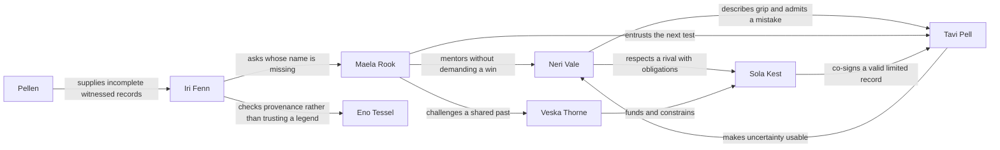

# Project Apex original universe and franchise

All creative material below is **proposed fiction and design**, written for this brief on 9 November 2026. It is not implemented content, established audience demand, cleared intellectual property, or a representation of a shipped product. Names, silhouettes and combinations need human creative review and professional clearance before publication. No claim of unprecedented storytelling is made. The source of the design requirements is the user's Project Apex brief; the source of current implementation context is the repository, not competitor inference.

## What is the original identity and emotional proposition?

### Takeaway

Keep **VelocityVerse** as an uncleared working franchise identity and name its first story **The Openline**. Build a world in which a race can settle a sporting contest while the choices around the race reveal what a crew is willing to share, admit and protect. The central emotional question is: **Can you become exceptional without leaving your people behind?**

### Cited Findings

- The existing prototype already names Lumen Harbor, Harbor Loop, Kestrel VX-1, Mesa Ardent and Halcyon Ring, so retaining them reduces a gratuitous creative reset. The existing architecture separates simulation from rendering and treats other worlds as proposals. These are internal project facts, not external market evidence — [current README](../../README.md), [existing product plan](../../docs/PRODUCT_PLAN.md).
- The new brief explicitly requests original characters, cities, mechanics and a small first playable before expansion. It does not require implementing eighteen characters or ten cities in the current app — [user brief](</Users/swetha/.codex/attachments/d2fed71c-4354-438a-ab7b-bc1beec9d05c/Pasted text.txt>).

### Inferences

**Working identity.** VelocityVerse is the umbrella; *The Openline* is a season/subtitle rather than a second app or fictitious launch announcement. Player-facing promise: **Make your mark. Leave the line open.** A brand mark could be two offset lane segments with a deliberate gap, representing both a racing line and room for another person. Avoid checkered-flag clutter, superhero crests, official motorsport marks and copied red Formula-style typography. This is a direction to prototype, not a cleared logo.

**Setting.** A chain of technologically uneven cities shares a voluntary engineering archive called the Openline. Its records describe how people measured, repaired and improved things, including racing cars and closed circuits. A record is useful because it includes uncertainties and failures. Its old agreement allowed a small workshop to learn from a large team's work without pretending all inventions belong to everyone. Licences, safety certification and attribution still matter.

The most prestigious championship operator, **Crownline**, wants exclusive commercial control over the archive's competition-standard data. Its argument is credible: it finances marshals, insurance, accessibility and inspection, while open records can be copied incorrectly. Openline crews argue that accountable public access is possible without enclosing the archive. Neither side is universally right. The antagonism is about trust and control, not defeating an evil corporation by driving faster.

**Central mythology.** Forty-one years earlier, city engineers agreed to publish nine shared measurement standards after incompatible timing systems produced a disputed championship and concealed an unsafe test. Eight standards survive. The **Ninth Measure** was not a secret energy source: it was an agreement to preserve the provenance of a measurement, including who could challenge it. Different cities remember the dispute differently. The mystery therefore creates reasons to meet people and test evidence; it never invalidates physics or grants a combat power.

**Genre and tone.** Energetic, optimistic engineering adventure with genuine rivalry, warm failure and occasional melancholy. The visual world is aspirational and inhabited: repair stitches, personal charms, accessible ramps, old event tickets, heat-marked tools, working crowd routes and places to sit. Racing occurs at closed venues with marshals and safety rules. Teen characters can compete in a fictional licensed category; the fiction does not teach dangerous road behavior. Loss can cost a trophy or require a new approach, never a purchased life or a relationship that dies because the player missed a day.

**Distinctive emotional loop.** Race → interpret one understandable trace → choose whose contribution to credit or which repair to prioritize → see a bounded change in the crew's place. The player can point to the school bench they helped open and remember who made it. A race result, a relationship scene and a garage object share one causal history. This is a meaningful combination to test, not proof that no game has connected sports, story and building before.

**Four anchors.** Neri wants a future; Tavi wants to be certain; Maela wants to deserve trust; Sola wants to choose her own loyalty. Their first story works even if a player never learns the wider world's proper nouns. The opening should contain four characters, one place, one practical problem and one race objective. Other characters enter only when they change something the player can do or understand.

### Gaps

- No naming, character-design, trademark, domain, store, merchandise or international linguistic clearance has been performed. Distinctive names here are creative candidates, not protected ownership claims.
- No evidence yet establishes that players care about this cast or prefer this loop. Table reads, silhouette tests, concept preference and repeated hands-on sessions must determine whether to retain it.
- The existing prototype has no character relationship or mission system. This bible must not be presented as a screenshot of an implemented universe.

## Who are the eighteen original characters?

### Takeaway

The initial eighteen form a usable story network, with four production priorities and fourteen bible-level supporting roles. Each has a readable silhouette and an ambition that exists outside the player's praise. Abilities below mean learned expertise or bounded fictional technology, never a disguised superhero power.

### Cited Findings

- The brief requires fifteen to twenty characters with twelve specific fields, plus only four in the first playable — [user brief](</Users/swetha/.codex/attachments/d2fed71c-4354-438a-ab7b-bc1beec9d05c/Pasted text.txt>).
- The existing game has one original vehicle model and prototype rival names rather than a narrative cast — [current README](../../README.md).

### Inferences

### 1. Neri Vale — the first anchor / seventeen / she

1. **Name:** Neri Vale; no superhero alias. 2. **Silhouette:** compact forward-leaning stance, a broad soft collar, one triangular hip pouch and a short crescent-shaped ponytail; recognisable in a black thumbnail without a helmet. 3. **Personality:** quick improviser, dry humor, generous with practical help and terrible at waiting. 4. **Origin:** grew up above Lumen Harbor's community garage; her mother runs a ferry maintenance crew. She learned to notice vibrations before she understood equations. 5. **Ambition:** earn a legitimate test-driver place without the garage becoming her sponsor's showroom. 6. **Conflict:** mistakes action for usefulness and assumes asking for help makes her replaceable. 7. **Expertise:** describes subtle braking and grip changes in vivid ordinary language; she cannot calculate a complete setup. 8. **Identity:** deep teal suit with a coral collar fold, pale ceramic helmet carrying two off-center ventilation slots. 9. **Relationships:** Tavi's closest collaborator; Maela's impatient pupil; Sola's inconvenient admirer. 10. **Arc:** from proving she is fastest to giving others the evidence and space to contribute. 11. **Universe connection:** her garage holds the oldest surviving Harbor Openline terminal, not a hereditary magical destiny. 12. **Animation/merchandise:** expressive hands and a folding collar translate into animation; articulated figure, helmet and a reusable tool pouch provide objects with story meaning.

### 2. Tavi Pell — the first anchor / nineteen / they

1. **Name:** Tavi Pell. 2. **Silhouette:** tall, narrow, soft rectangular hair, a split work apron that folds into two stiff leaf-shaped pockets; hands often frame imaginary dimensions. 3. **Personality:** observant, precise and unexpectedly playful when turning a complicated idea into a small model. 4. **Origin:** moved from reservoir maintenance at Plume Reach after a placement examiner dismissed their unconventional tactile prototypes. 5. **Ambition:** create instruments that a beginner can understand without surrendering precision. 6. **Conflict:** hides uncertainty behind extra detail; when a prediction fails, they rewrite the explanation before admitting the prediction was wrong. 7. **Expertise:** sensor design, physical models, uncertainty and test design; practical fabrication remains Patch's strength. 8. **Identity:** warm ivory apron, cobalt underlayers and a coral flexible ruler worn as an adjustable loop. 9. **Relationships:** Neri supplies language for measurements; Maela gives responsibility too early; Asha challenges their assumption that a graph is universally readable. 10. **Arc:** learns to publish an honest range and invite a second observer. 11. **Connection:** develops the first player-readable reconstruction of the Ninth Measure's evidence chain. 12. **Extension:** fold-out model kits and illustrated “try two hypotheses” shorts; no expensive pretend scientific instrument sold as accurate equipment.

### 3. Maela Rook — the first anchor / fifty-one / she

1. **Name:** Maela Rook. 2. **Silhouette:** broad shoulders, cropped silver hair and a low mobility chair with crescent side guards and a fold-out pit console. She is also visually distinct when transferred into a cockpit. 3. **Personality:** teasing, patient with learners and fierce about credit. 4. **Origin:** retired endurance champion who returned to Harbor and turned a sponsor garage into a cooperative workshop. Her disability is part of daily life; the story does not require a cure or a secret enhancement. 5. **Ambition:** leave a school that survives her own reputation. 6. **Conflict:** a past team pressured her to sign a timing report she did not fully verify; her public certainty hides shame. 7. **Expertise:** race judgment, teaching and adapting controls to the driver. 8. **Identity:** indigo jacket with long horizontal repair seams, amber lenses and brushed aluminum chair details. 9. **Relationships:** guardian figure to Neri without replacing her family; trusted employer to Tavi; former teammate of Veska. 10. **Arc:** earns trust by naming the limit of her old evidence. 11. **Connection:** holds one incomplete account of the archive dispute, not all its answers. 12. **Extension:** mentorship shorts, a functional accessible garage playset and a figure with an accurately designed chair reviewed by disabled collaborators.

### 4. Sola Kest — the first anchor / twenty-two / she

1. **Name:** Sola Kest. 2. **Silhouette:** upright long-limbed pose, a single squared jacket shoulder and a thick short braid held inside an angular fabric sleeve. 3. **Personality:** disciplined, charismatic and privately absurd about harmless rituals such as naming her packed lunches. 4. **Origin:** won a scholarship from Mesa Ardent into Crownline's development program. Her wage supports a family repair business. 5. **Ambition:** become a champion whose decisions are her own, not merely a profitable face. 6. **Conflict:** rightly fears that a public stand can hurt teammates who never chose the argument. 7. **Expertise:** consistent race execution and giving actionable feedback under pressure. 8. **Identity:** chalk-white and burnt orange with a dark plum helmet visor frame; a paired offset rectangle motif, not a superhero crest. 9. **Relationships:** respectful rival to Neri, protected by Veska, long friendship with Juno. 10. **Arc:** moves from quiet favors to an accountable, limited challenge of league policy. 11. **Connection:** her official test evidence can validate Harbor's repair even when she wins the race. 12. **Extension:** rival-versus-ally animated scenes, collector racewear and a two-car set whose story supports cooperation as well as competition.

### 5. Oren “Patch” Daal — mechanic / thirty-four / he

1. **Name:** Oren Daal, called Patch by friends. 2. **Silhouette:** wide barrel apron over thin legs, one rolled sleeve and a folded triangular stool clipped flat to his back. 3. **Personality:** welcoming, deadpan and superstitious about labeling drawers, not machines. 4. **Origin:** repaired cargo lift brakes in Ostrail Works before following Maela to Harbor. 5. **Ambition:** publish repair instructions that survive losing the original expert. 6. **Conflict:** keeps fixing everything himself because teaching feels slower. 7. **Expertise:** joining materials, serviceability and diagnosing loose connections; cannot invent impossible performance from scrap. 8. **Identity:** mustard canvas, oxidized turquoise tabs and hand-sewn numbered stitches. 9. **Relationships:** clashes affectionately with Tavi's fragile prototypes; respects Dema's refusal to waste components. 10. **Arc:** lets an apprentice repair something while he watches. 11. **Connection:** recognizes incompatible fastener marks that help date an archive object. 12. **Extension:** safe snap-fit construction kits, stop-motion repair shorts and a foldable stool accessory; tools for children remain age-rated toys.

### 6. Veska Thorne — institutional antagonist / forty-six / she

1. **Name:** Veska Thorne. 2. **Silhouette:** very tall oval coat, close shaved hair and a narrow vertical inspection ledger always held with two hands. 3. **Personality:** precise, reserved and capable of sincere kindness she would prefer to keep private. 4. **Origin:** organized emergency marshaling after a poorly governed invitational; later helped build Crownline's reliable event operations. 5. **Ambition:** make every sanctioned race safe, solvent and predictable. 6. **Conflict:** treats a manageable uncertainty as a threat to institutional legitimacy and confuses control with care. 7. **Expertise:** logistics, standards and negotiation; no omniscient surveillance. 8. **Identity:** smoke plum, porcelain trim and a small amber inspection seal. 9. **Relationships:** former teammate of Maela, Sola's protective employer, rival to cooperative founder Hadi. 10. **Arc:** is forced to accept auditable dissent or lose the people her system protects. 11. **Connection:** Crownline's enclosure has her signature, but its motives are contested within the organization. 12. **Extension:** dramatic antagonist figure and negotiation-focused episodes; never sell her philosophy as an unavoidable premium upgrade.

### 7. Juno Venn — charming rival / twenty-three / he

1. **Name:** Juno Venn. 2. **Silhouette:** compact square torso, long narrow boots, relaxed sideways stance and a jacket with one wide circular cuff. 3. **Personality:** charming, observant and hilarious at reading a room until a joke avoids a necessary apology. 4. **Origin:** performed timing demonstrations at city festivals, then earned a touring series seat. 5. **Ambition:** own his team's media rather than be a disposable personality. 6. **Conflict:** fears the silence after his audience moves on. 7. **Expertise:** reading overtaking opportunities and communicating race decisions. 8. **Identity:** vermilion, pale blue and a stitched open-circle cuff. 9. **Relationships:** Sola's old training partner; Perri's friendly professional rival; Neri sees through his bravado. 10. **Arc:** makes a costly honest correction without turning it into a performance. 11. **Connection:** can bring Crownline spectators to the cooperative without pretending his fans are automatically members. 12. **Extension:** comedy shorts, gesture-rich animation and a reversible race jacket.

### 8. Iri Fenn — strategist and archivist / twenty-seven / she

1. **Name:** Iri Fenn. 2. **Silhouette:** short angular bob, a broad low satchel and a translucent fan of physical index tabs. 3. **Personality:** quiet, incisive, surprisingly enthusiastic about mundane local customs. 4. **Origin:** her family's archive was relocated repeatedly during Veyglass redevelopment, leaving gaps in its authorship records. 5. **Ambition:** return correct names to forgotten work. 6. **Conflict:** suspects every omission is deliberate and can hurt innocent people by refusing an ordinary explanation. 7. **Expertise:** evidence comparison, route planning and historical research. 8. **Identity:** sea-green translucent tabs, ink-black cloth and one warm orange bookmark. 9. **Relationships:** distrusts Eno's private notebooks; Maela fears her questions; Pellen becomes her most irritating witness. 10. **Arc:** distinguishes a plausible account from proof. 11. **Connection:** tracks the Ninth Measure across cities while preserving disagreement. 12. **Extension:** fold-out map books, story puzzles and a recognizable satchel; mysteries work without collectible purchases.

### 9. Brann Oru — civic builder / thirty-nine / he

1. **Name:** Brann Oru. 2. **Silhouette:** deep triangular rain cape, broad flat cap and a long hinged measuring staff carried horizontally. 3. **Personality:** reassuring in a storm, awkward at celebration and stubborn about commitments. 4. **Origin:** Serein Span bridge maintenance engineer elected as a workers' event coordinator. 5. **Ambition:** show that public access and rigorous inspection can coexist. 6. **Conflict:** promises too much to too many crews because refusing feels disloyal. 7. **Expertise:** structural monitoring and safe route closure planning. 8. **Identity:** storm blue, warm yellow edge binding and matte steel. 9. **Relationships:** respects Veska's competence, supports Hadi's cooperative, refuses Neri shortcuts. 10. **Arc:** learns to set a boundary before a promise becomes unsafe. 11. **Connection:** controls permission for a later closed-bridge demonstration, not the city's entire infrastructure. 12. **Extension:** bridge-building activities, weatherproof toy cape and practical teamwork stories.

### 10. Asha Mire — access and acoustic designer / twenty-six / she

1. **Name:** Asha Mire. 2. **Silhouette:** neat round hair shape, short rectangular vest and a wide wrist-mounted tactile pad rather than dangling gadgets. 3. **Personality:** candid, curious and competitive at cooperative puzzles. 4. **Origin:** built community performance equipment in Veyglass and discovered how badly many racing instruments relied on one sensory channel. 5. **Ambition:** make high-performance feedback usable by more bodies and senses. 6. **Conflict:** overgeneralizes a successful solution until another user shows it does not work for them. 7. **Expertise:** acoustic diagnosis, haptic signaling and access testing; sound never detects information a sensor has not measured. 8. **Identity:** raspberry, graphite and soft ivory ribbed surfaces. 9. **Relationships:** productive friction with Tavi; Maela insists on being a collaborator, not an inspiring example. 10. **Arc:** replaces universal claims with adjustable tools and real listening. 11. **Connection:** gives the Openline a multisensory interface. 12. **Extension:** sound-design shorts and inclusive tactile activity books developed with appropriate specialists.

### 11. Eno Tessel — inventor / sixty-two / they

1. **Name:** Eno Tessel. 2. **Silhouette:** small round body, three offset rectangular hair panels and a coat that opens into a broad portable work surface. 3. **Personality:** delighted by weird prototypes, impatient with publicity and capable of evasive jokes. 4. **Origin:** worked on the original Openline's portable calibration tools; left when institutions turned their unfinished designs into promises. 5. **Ambition:** make one truly repairable instrument that outlives its manufacturer. 6. **Conflict:** hoards unfinished work to avoid being wrong publicly. 7. **Expertise:** deployable mechanisms and instrument calibration; no time travel or perpetual motion. 8. **Identity:** moss, warm copper and square pale patches. 9. **Relationships:** Iri seeks their records; Tavi initially idolizes them; Patch is unimpressed by impractical hinges. 10. **Arc:** releases a useful imperfect design with explicit limits. 11. **Connection:** can explain why the archive lost a version, but not which version is morally correct. 12. **Extension:** folding mechanism toys and comedy of invention animation.

### 12. Luma Quill — young observer / twelve / she

1. **Name:** Luma Quill. 2. **Silhouette:** broad triangular backpack, close curled hair and oversized square binoculars on a short safety strap. 3. **Personality:** literal, earnest and relentless about unfair explanations. 4. **Origin:** visits the garage's supervised science club after school; her parent works in its cafe. 5. **Ambition:** make a complete field guide to the circuit's unnoticed jobs. 6. **Conflict:** worries that being a beginner means nobody should listen to her. 7. **Expertise:** careful observation and recording changes; adults verify conclusions and she never performs risky maintenance or race driving. 8. **Identity:** leaf green, coral socks and a pale checker notebook without brand marks. 9. **Relationships:** Patch's supervised apprentice; Perri records her question segments; Neri is the older friend she can challenge. 10. **Arc:** learns to ask better questions and ask for help. 11. **Connection:** finds a mundane label everyone else ignored. 12. **Extension:** field-guide books, binocular toy and short safe science episodes for younger audiences.

### 13. Hadi Rell — cooperative founder / thirty-two / he

1. **Name:** Hadi Rell. 2. **Silhouette:** long soft sleeveless coat, rolled document tube and a conspicuous flat oval tote for event supplies. 3. **Personality:** persuasive, practical and quietly funny about budgets. 4. **Origin:** ran food and transport logistics for independent race weekends, then formed a cooperative when crews could no longer afford separate equipment. 5. **Ambition:** create a league in which a small team can survive a bad season. 6. **Conflict:** can treat friendship as another resource to schedule. 7. **Expertise:** budgets, cooperative governance and event delivery. 8. **Identity:** clay red, warm cream and ink-blue handwritten labels. 9. **Relationships:** Maela trusts him with money; Veska considers his safeguards incomplete; Karo demands he respect crew rest. 10. **Arc:** learns that consensus takes time and a sustainable calendar needs fewer promises. 11. **Connection:** founder of the proposed Openline Relay Cup. 12. **Extension:** team-management side stories and a reusable event-planning game, without pretending fiction teaches financial certainty.

### 14. Perri Nox — commentator and documentarian / twenty-four / they

1. **Name:** Perri Nox. 2. **Silhouette:** elongated diamond jacket, a short spring of hair and a compact microphone inside a half-circle handle. 3. **Personality:** electric on air, thoughtful off air, prone to explaining a stranger's emotion too confidently. 4. **Origin:** recorded neighborhood event audio at Plume Reach, then gained a touring commentary role. 5. **Ambition:** make smaller teams' stories audible without manufacturing heroes and villains. 6. **Conflict:** a beautiful narrative can tempt them past the evidence. 7. **Expertise:** race commentary, interviews and editing. 8. **Identity:** electric blue, warm coral lining and frosted microphone shell. 9. **Relationships:** Juno trades jokes, Iri demands corrections, Luma asks the best questions. 10. **Arc:** makes uncertainty compelling instead of hiding it. 11. **Connection:** provides authored summaries of player accomplishments and the world's competing historical accounts. 12. **Extension:** short audio dramas and an actual story podcast; in-game lines remain bounded rather than unrestricted AI conversation.

### 15. Dema Sol — materials researcher / thirty-six / she

1. **Name:** Dema Sol. 2. **Silhouette:** wide brim folded only at the back, narrow rectangular tunic and a large circular sample carrier at one hip. 3. **Personality:** patient, sharply witty and almost impossible to rush. 4. **Origin:** grew up sorting retired panels in Nacre Yard and now studies what can actually be reused. 5. **Ambition:** establish honest material passports that include repair and end-of-life limits. 6. **Conflict:** dismisses emotional attachment as waste until a repair has value beyond efficiency. 7. **Expertise:** fatigue testing, surface finishes and reuse tradeoffs; not every recycled part is safe for racing. 8. **Identity:** salt white, dusty orange and a single dark blue sample ring. 9. **Relationships:** Patch admires her standards; Eno resents destructive testing; Karo trusts her refusal to overclaim. 10. **Arc:** balances meaning, safety and resource use. 11. **Connection:** identifies that a supposedly original archive casing is a later repair. 12. **Extension:** material-sorting activities and a repair-focused capsule collection with substantiated sourcing rather than fictional environmental claims.

### 16. Karo Vey — endurance captain / twenty-eight / he

1. **Name:** Karo Vey. 2. **Silhouette:** broad rounded shoulders, close hair and two long vertical fastening straps on a soft overshirt. 3. **Personality:** calm, attentive and stubborn about rest; fierce competitiveness emerges in precise decisions. 4. **Origin:** ran timed closed-course service relays in the Orren Steps before becoming an endurance racer. 5. **Ambition:** build a championship-winning team that does not consume its people. 6. **Conflict:** avoids a needed confrontation to preserve calm. 7. **Expertise:** stint consistency, energy budgeting and shared decision protocols. 8. **Identity:** glacier blue, dark aubergine and two warm amber tabs. 9. **Relationships:** checks Hadi's calendar, mentors Sola on team boundaries and challenges Neri's one-lap heroics. 10. **Arc:** learns that speaking up early is a form of care. 11. **Connection:** leads a later endurance chapter where clean coordination matters more than individual fame. 12. **Extension:** ensemble race animation and cooperative tabletop relay play.

### 17. Pellen — archive service automaton / service age eleven

1. **Name:** Pellen, formerly unit PL-11; pronouns it/they by localized story convention. 2. **Silhouette:** three offset ceramic discs on two low wheels, a small upright rectangular signal leaf and no human face. 3. **Personality:** meticulous about ordinary objects, comically poor at deciding which detail is relevant; apparent attachment is authored characterization, not a claim about machine sentience. 4. **Origin:** maintained Harbor's old timing terminal through years of disuse. 5. **Ambition:** complete a record of everyone who helped restore it. 6. **Conflict:** treats preserving every fragment as more important than asking whether someone wanted it kept. 7. **Expertise:** moving physical archive media and verifying a record's checksum; it cannot infer truth from a valid checksum. 8. **Identity:** cream ceramic, sea-green flexible belt and one warm amber signal leaf. 9. **Relationships:** Iri relies on its record but questions its interpretation; Luma teaches it the difference between a name and a private note. 10. **Arc:** learns a consent-based deletion ritual. 11. **Connection:** holds a damaged, openly incomplete sequence of the Ninth Measure's revisions. 12. **Extension:** wheeled toy, expressive sound language and short animation; no child-monitoring companion device is implied.

### 18. Reva Anik — independent challenger / twenty / she

1. **Name:** Reva Anik. 2. **Silhouette:** short robust stance, fan-shaped tightly bound hair and a jacket with a low diagonal apron panel. 3. **Personality:** blunt, resourceful and generous toward people she trusts; unforgiving when institutions ask for patience. 4. **Origin:** Cinderwell race workshop lost its license after a sponsor withdrew, though its safety inspection remained valid. 5. **Ambition:** create a path into racing that does not require a marketable personal story. 6. **Conflict:** risks turning justified anger into careless accusation. 7. **Expertise:** low-budget setup iteration and maintaining consistent control with limited test time. 8. **Identity:** charcoal, kiln orange and dusty pale pink stitched panels. 9. **Relationships:** Neri understands her anger; Sola embodies opportunity she was denied; Veska sees both ability and risk. 10. **Arc:** learns to challenge a rule with evidence and allies rather than a solitary stunt. 11. **Connection:** organizes the **Quiet Grid**, an informal but venue-sanctioned evening trial series; no illegal street racing is required. 12. **Extension:** independent-team comic arcs, expressive racing figure and customizable patches.

**Relationship engine.** Begin with Neri↔Tavi's speed-versus-certainty tension, Maela↔Veska's disputed shared past, and Neri↔Sola's respect under unequal opportunity. Add Hadi↔Karo when management becomes playable; add Iri↔Eno↔Pellen for the archive mystery. Do not introduce eighteen voices at once. Relationships change through witnessed choices, include reconciliation and can disagree without a punitive “friendship meter.” Never sell affection, certainty or an apology.

### Gaps

- The names and silhouettes need actual concept sheets, cast readings, cultural review, animation tests and clearance. Biographies alone do not create memorable characters.
- Disability/access representation requires paid lived-experience collaboration; a chair in concept art is an opening commitment rather than validation.
- Age/rating/localization and player identification need testing. The proposed protagonist age does not determine legal audience classification.

## What are the cities, circuits, cultures and history?

### Takeaway

Ten city concepts and twelve circuits create a long-term geography, but only Lumen Harbor and Harbor Loop belong in the first playable. The places are defined through material, work, public life and racing behavior; another color palette alone does not make another world.

### Cited Findings

- Harbor Loop's current implementation is described as a 2.10 km circuit with nine corners; other physical world concepts are not authored playable locations — [existing plan](../../docs/PRODUCT_PLAN.md), [current README](../../README.md).
- The prototype currently omits elevation, wear and physical wet-weather grip; proposed geography cannot silently become a claim that those systems exist — [limitations](../../README.md).

### Inferences

### Proposed historical spine

Use relative years initially so localization does not confuse the fiction with real history. **Year 0:** the Disputed Relay exposes incompatible timing and opaque certification; the Openline covenant begins. **Year 8:** the cities fund shared workshop terminals. **Year 19:** Veyglass redevelopment disperses an archive and strips context from several records. **Year 27:** the Quiet Season, a calendar suspended after equipment certification failures, creates a public appetite for reliable oversight. **Year 31:** Crownline standardizes successful event operations, initially with broad support. **Year 38:** commercial contracts begin restricting redistribution of new certified records. **Year 41/present:** Harbor's old terminal is restored; its incomplete provenance makes the Ninth Measure relevant again. These are inventions, not analogies claiming knowledge of any real motorsport incident.

### Ten proposed cities

| City | Geography and visual life | History and racing culture | Gameplay opportunities and secret place |
|---|---|---|---|
| **Lumen Harbor** | Tidal coast; stone breakwaters beneath new luminous transit spans; warm kitchens and repair shops inside large industrial shells. Copper, sea teal and sun-worn ivory. | Ferries and race workshops shared early timing tools. Locals prize repeatable clean laps and helping a stranded crew. Neri and Maela's home. | Braking and grip lessons, short sprints, beacon provenance quest. **The Bell Room**, a safe public archive behind the old marshals' post, holds annotated timing cards. |
| **Mesa Ardent** | Dry plateau city around shaded courtyards, solar towers and wind-shaped rammed-earth walls. Orange, cobalt and white ceramic. | Once provided cooling equipment for touring events; its young engineers founded a scholarship championship. Sola remembers its community differently from sponsor advertising. | Drag/downforce tradeoffs and later energy management; dust/heat effects only after modeling. **The Shade Engine**, a retired passive-cooling demonstrator, opens through a engineering puzzle, not trespass. |
| **Veyglass** | Steep flood terraces, vertical rail elevators and translucent wind screens; homes have hanging gardens and public lift plazas. Violet dawn, clear glass and lime foliage. | Rebuilding created the world's best access routes but scattered old neighborhood records. Racing is precise, spatial and choreographed around closed festival routes. | Later elevation, linked corners and route planning. **The Unnumbered Landing** is a preserved public observation deck whose handrail carries an erased workshop maker's mark. |
| **Orren Steps** | Cold mountains; switchback service railways, timber shelters and thick stone buttresses. Glacial blue, rust and wool gray. | Cooperative relay crews shared rescue and maintenance duties long before televised racing. Finishing together has more status than a spectacular qualifying lap. | Later elevation and endurance consistency. **The Listening Shelter** has a wind instrument whose records distinguish two historical event dates. |
| **Ostrail Works** | A geothermal industrial city extending through broad daylight wells and cavernous workshops; clear ventilation and accessible transit keep underground spaces inhabited. Ochre, metal green and amber. | Workers insisted that every race venue show how it could be maintained. Patch learned his craft here. | Serviceability missions, acoustic feedback and low-light readability. **The Third Shift Wall** preserves anonymized repair lessons, including a deliberate correction to a celebrated engineer's account. |
| **Plume Reach** | Wetland-edge city of reed roofs, raised courtyards and floating research pontoons; protected habitat remains outside race routes. Green, pale sky and warm terracotta. | Water monitoring made uncertainty a civic habit; children learn to record ranges, not pretend a single reading is perfect. Tavi and Perri's different ways of explaining data began here. | Sensor calibration, later wet-grip trials, energy and habitat-aware route design. **The Quiet Observatory** unlocks a story by observing without touching or driving into habitat. |
| **Cinderwell** | Settled inactive caldera; kiln yards, stone arcades and reclaimed workshop courtyards. Charcoal, clay pink and molten-orange glazing. No active-lava race hazards. | Ceramic brake and insulation workshops support independent teams. Reva's Quiet Grid events showcase reliability on modest budgets. | Material fatigue, brake repeatability and budgeted setup challenges. **The Blue Kiln** contains failed samples with useful notes, challenging the myth that only successes deserve preservation. |
| **Serein Span** | Windy estuary bridges with hanging maintenance platforms and sheltered public gardens; large human spaces beneath the skyline. Storm blue and yellow. | Bridge workers control safe closures and insist race schedules respect ordinary journeys. Brann negotiates every event with residents. | Later crosswind, traffic-free sanctioned bridge sprint and marshaling strategy. **The Counterweight Hall** demonstrates how structure and measurement relate, with no dangerous access challenge. |
| **Nacre Yard** | Salt-edge recycling port, folded solar canopies and modular buildings made from genuinely inspected reused materials. Chalk white, dusty orange and ink blue. | Former salvage settlement created the world's clearest material passports; Dema refuses vague claims that all reuse is safe. | Reuse tradeoffs, efficiency and consistency events. **The Return Library** lets players compare objects across repair cycles rather than “collect trash” without purpose. |
| **Halcyon Ring** | A distant, pressurized orbital research habitat with visible curvature and a large enclosed civic garden. Soft green, pale gold and deep space. | The setting's distant technological ambition, financed by a research cooperative with its own political limits. It has inherited Openline standards without inheriting the old dispute's context. | Much later low-gravity/atmospheric physics, energy and research competition. **The First Window** shows the archive's oldest test object, not a portal. Separate production feasibility gate; no orbital map in the first release. |

Halcyon is intentionally one long-term destination, not permission for a multiverse where any inconsistency is explained away. The cities are interdependent through components, people and evidence. Their climate and materials constrain design; do not assign a real culture as a single city's costume.

### Twelve proposed circuits

Lengths/corner counts except the current Harbor summary are design targets, not built geometry or real telemetry. New physical effects are not implied by menu cards.

| Circuit / city | Proposed scale and character | Sporting category and lesson | History or story use |
|---|---|---|---|
| **Harbor Loop / Lumen Harbor** | Existing summary: 2.10 km, nine corners, waterfront braking zone, chicane and a broad fast sweep. | First playable spec single-seater; separate assisted classes. Readable braking, grip and a clean lap. | Restore timing beacon, meet Sola and validate a workshop's test record. Preserve actual implementation geography for continuity. |
| **Beacon Return / Lumen Harbor** | Proposed 1.18 km, eight corners, closed training apron and short breakwater straight. | Later low-speed academy and accessible-control trials. | The school course built only after first-season approval; a visible legacy of the first mission. Not a dangerous public street shortcut. |
| **Mesa Weave / Mesa Ardent** | 3.80 km, fourteen corners; shade structures repeat at known intervals between long sweepers. | Spec sprint and aero experiment; compare confidence and actual speed. | Sola's scholarship course, where an old test result gets reinterpreted rather than erased. |
| **Thermal Ladder / Mesa Ardent** | 5.10 km, eighteen corners; two long straights connected by a technical interior section. | Later electric endurance and energy strategy after battery/tire validation. | Karo and Hadi disagree over a test schedule that needs crew rest. Heat is initially atmosphere only. |
| **Glasslift Circuit / Veyglass** | 3.20 km, sixteen corners over a broad terraced route with safe elevation changes. | Later lightweight closed-wheel class; spatial memory and slope-aware braking. | Neighbors contest the event calendar; preserving an accessible crossing becomes a design constraint. |
| **Summit Stitch / Orren Steps** | 4.60 km, seventeen corners on a closed alpine facility, open sight lines and runoff. | Later relay endurance; repeatability and handover. | A mentorship chapter reveals why finishing a modest stint can help more than one heroic lap. |
| **Foundry Echo / Ostrail Works** | 2.90 km, twelve corners through high daylight wells and fully ventilated enclosed segments. | Workshop challenge and acoustic feedback; audio accessibility variants. | Patch lets someone else perform an inspected repair; no driving through active workers. |
| **Reedwake Circuit / Plume Reach** | 3.00 km, thirteen corners on purpose-built causeways outside protected reeds. | Later changing-condition trials; sensor uncertainty and surface classes. | A failed forecast is accepted honestly; player learns a credible range rather than “perfect weather AI.” |
| **Kiln Crown / Cinderwell** | 3.40 km, fifteen corners, repeated braking zones around inactive industrial courtyards. | Independent spec cup; consistent brake technique, materials after modeling. | Reva challenges a licensing restriction through a properly witnessed test. |
| **Crosswind Reach / Serein Span** | 4.20 km, eleven corners on a controlled bridge-and-plaza facility. | Later crosswind sprint with separately validated conditions. | Brann's safe closure requirements are an interesting planning constraint; no bonus for ignoring them. |
| **Sunfold Oval / Nacre Yard** | 3.60 km, six principal bends; broad oval with an optional inspected infield connection. | Later efficiency and team relay; draft and energy tradeoffs. | Dema shows why the apparently sustainable component fails a race-duty test. |
| **Lowlight Arc / Halcyon Ring** | 4.00 km, fourteen corners in an enclosed research band; initially planar within local habitat frame. | Distant experimental category with explicitly modeled gravity and air. | Tests whether the covenant's reasoning travels better than its exact numbers. Do not promise loops or gravity transitions before physics support. |

### Categories, institutions and hidden challenges

**Categories.** First playable: the existing Kestrel VX-1 in the **Open Spec** category, one homologated performance envelope, cosmetic identity and clear assist classes. Later: **Utility Relay** with original closed-wheel service-inspired vehicles; **Current Endurance** for electric powertrains with modeled energy use; **Workshop Trials** for isolated non-ranked experiments; **Research Class** as distant experimental rules. Buying a character, story or body shell must never create competitive grip.

**Institutions.** **Crownline** operates a premium global championship and rigorous standardization. **The Ribbon Guild** is a federation of workshop educators and repair cooperatives; it has uneven resources and imperfect governance. **The Brass Cartographers** maintain routes, venue histories and credited records; they can disagree over access. **The Quiet Grid** is Reva's invitation-based, sanctioned evening test network. “Underground” means overlooked by mainstream media, never an instruction to race dangerously on roads. No faction is coded as a simple real country or ethnicity.

**Championships.** The prestigious **Crownline Crown** is a sporting goal, not the universe's moral center. The proposed **Openline Relay Cup** makes a crew's transparent preparation and clean result visible. A later **Nine Measures Invitational** combines separate categories with comparable rules, rather than a single score that lets one kind of player dominate. These remain design titles and require clearance.

**Hidden challenges.** Find a repair's provenance; reproduce a braking result within a range; identify which sensor could falsify a favorite theory; hear an audio landmark with an equivalent visual/tactile clue; leave a useful annotated record for a future visitor. No timed disappearance, paid clue or friendship penalty. A secret location is a safe authored discovery, not access to real private property.

### Gaps

- Ten cities are a franchise map, not a twelve-month asset production promise. Each requires blockout, cultural research, licensed/original asset work and device budgets before production.
- Later elevation, battery systems, crosswind, rainfall, endurance and gravity are separate engineering tasks. Fiction does not solve their validation requirements.
- World economics and travel distances deliberately remain broad until narrative and gameplay blockouts make them necessary; invented geological precision would add little value now.

## What story should the first playable tell, and how can it grow?

### Takeaway

Ship one small, complete emotional arc: the crew restores a timing beacon and earns the evidence needed to open a community training space. Success requires honest testing and controlled driving; beating Sola is optional. The franchise earns expansion when people want more time with the crew.

### Cited Findings

- The current prototype already has practice, academy drills, local progression, paint and a simulation experiment lab, providing possible ingredients for a compact authored mission rather than requiring a new open world — [README](../../README.md), [existing plan](../../docs/PRODUCT_PLAN.md).
- The brief asks for a character-driven mission, persistent data and a team/community experience in the first playable, while postponing the full universe — [user brief](</Users/swetha/.codex/attachments/d2fed71c-4354-438a-ab7b-bc1beec9d05c/Pasted text.txt>).

### Inferences

### First story: The light we leave on

**Scene 1, 45–60 seconds.** The player arrives for a supervised workshop open day. Neri has cleaned a space that used to be a timing booth; its beacon does not work reliably. Maela needs a valid inspection record before the booth can become a teaching room. Nobody's home is threatened by a single lost race. Tavi says the signal delay is known; a second reading contradicts them. Sola arrives for a homologation run with the witness equipment the workshop lacks. She has enough scheduled time for one session, making the choice concrete without a real-world countdown.

**Playable task 1, 2–3 minutes.** A short driving lesson measures a controlled stop. Neri describes the feel, Tavi shows the actual speed trace with a range and one possible explanation. A missed target produces a warm response and immediate retry, not crew disappointment. Accessible assists can finish the story; competitive records retain explicit classes. The science claim is narrow: a sensor timing error can change an interpreted stopping distance, so compare measured events rather than favorite explanations.

**Crew choice, 30 seconds.** Publish the first trace with its uncertainty and ask Sola for a repeat, or keep it provisional and perform a slower calibration first. Both paths reach a safe valid record; the tradeoff is which crew member leads the explanation and what the garage later displays. No branch says “lie and get more XP.” A later decision chooses whether the teaching room's first exhibit explains braking through a tactile model or a replay. Both can become available through normal play; this is early authorship, not permanent loss.

**Playable task 2, 3–5 minutes.** Complete one clean homologation lap or a bounded sequence of valid sectors. Winning is an optional sporting ambition. A valid completion with the selected assists is enough; the system cannot declare a publishable measurement from a telemetry overlay alone. Retry the relevant section after failure rather than the entire dialogue. Sola can win while still choosing to co-sign the openly limited record. That lets her be a rival with agency instead of a reward dispenser.

**Resolution, 60 seconds.** The timing beacon turns on during an authored celebration. The saved garage shows a real completion plaque, chosen exhibit, current livery and names of the contributors. Tavi adds “what we still don't know”; Maela publicly corrects one detail of her past. Neri asks the player which small project to try next. No attendance demand, ominous push notification or disappearing story follows. A player who stops here has a satisfying ending.

**Persistent state, proposed.** Save `beaconMissionVersion`, objective evidence summaries, chosen exhibit, credited collaborators and unlocked authored scenes alongside existing local progress. Keep raw sensitive user text out of generated dialogue. Relationships use a few comprehensible flags tied to witnessed decisions; they decay neither with time nor inactivity. Distinguish local records, verified future online records and story fiction. A technical checksum is not proof a story allegation is true.

**Team experience in this slice.** An authored four-person crew plus a customizable local team identity satisfies a modest team experience. It does not become “multiplayer” because characters speak to the player. A family handoff challenge can be optional and work on one device, with each person's consent; friend visits and public membership wait for accounts, safety operations and real demand.

### Three-season spine, contingent on validation

**Season one — The Openline.** Harbor repair → Sola's witnessed test → Iri's discovery that the archive has conflicting attributions → Maela's honest correction → a small invitational with publication of a bounded shared standard. The end answers the first mystery and keeps the workshop open. It does not withhold a purchased true ending.

**Season two — Borrowed certainty.** Mesa and Veyglass disagree about which records can be reused safely. Reva's exclusion and Hadi's cooperative force Sola to choose a specific policy challenge rather than simply defect. Tavi and Eno learn the difference between refusing false certainty and refusing responsibility. A real curriculum/creator pilot, if validated, can be mirrored by a fictional “publish a test” chapter.

**Season three — What we pass on.** Karo's relay team makes shared legacy tangible; Luma's guide records jobs famous drivers ignore. Veska can reform oversight if she accepts independent scrutiny, or retain institutional power while losing trust. The archive becomes governed by a legible council rather than mysteriously solving politics. Halcyon's distant invitation is an optional horizon, not a required escalation into saving planets.

### Franchise expansion ladder

1. **Playable game:** establish the four-character bond, one real venue and a complete small story. Proof: voluntary return and character recognition without showing the logo.
2. **Interconnected platform:** retain one identity and credited accomplishments across a small verified ghost challenge and engineering mission. Reuse the evidence/state contract; do not build a giant lobby before users want another mode.
3. **Character franchise:** commission silhouette sheets, voice/gesture tests and a canon guide. Promote characters whose scenes players quote or voluntarily revisit, not all eighteen equally.
4. **Animated shorts:** 2–4 minute situations such as Patch teaching an apprentice or Sola choosing what to credit. A short must deliver its own emotional ending and can introduce a later mission without making viewing mandatory.
5. **Comics/digital stories:** Iri investigates an attribution; Maela and Veska remember the same race differently. Comics deepen perspective and never contain required competitive information absent from the game.
6. **Merchandise/collectibles:** pilot Pellen as a tangible companion and a useful fold-out garage/measurement toy. Offer fixed contents and clear prices; no randomized chase products directed at children. Manufacturing, safety, returns and inventory require separate commercial gates.
7. **Education:** Tavi/Asha's supervised experiments use actual measured data and explicit limitations. Teacher materials stand alone and do not require a child's public account or gameplay purchase. Validate educational outcomes before claiming learning effectiveness.
8. **Tournaments:** Openline Relay events celebrate verified clean participation as well as a skill final. Separate skill classes, realistic schedules and accessibility; do not sell entry advantages.
9. **Licensing partnerships:** permit canon-compatible productions under a documented approval process and territory/category limits. A school or toy partner must strengthen character/world recognition, not turn the game into a logo wall.
10. **Entertainment ecosystem:** only after repeated demand, use a canon council, rights ledger and shared chronology to connect products. The game remains enjoyable without consuming the entire franchise.

These steps are demand gates, not a promised release calendar. Before animation, require that a deliberately sampled playtest cohort can recognize and describe the four anchors without prompted biographies; set the exact study threshold before testing. Before merchandise, conduct adult-payer interviews and a small fixed-content preorder experiment with explicit delivery/refund terms, then model landed cost and unsold inventory. Before school sales, run a teacher-reviewed learning study. Before tournaments, prove fair verification and the cost of operations in one small event. A positive game-retention result does not automatically validate a toy business or a school purchasing process.

### Candid creative founder review

This is a coherent ambitious franchise hypothesis, not a demonstrated billion-dollar asset. Its most defensible potential is the bond between a crew's decisions and an earned, understandable record. Racing, collecting, story branches, cooperative garages and engineering lessons already exist in games and entertainment; their combination is useful only if one loop feels unusually good.

The largest creative risk is exposition. An archive covenant can be meaningful to a writer and boring to a teenager. Begin with a broken light and four people, then reveal institutions through consequences. The second risk is mistaking moral instruction for drama: let Sola's obligations be real, allow disagreement, and let a player remain a respected crew member after a mistake. The third risk is visual sameness: eighteen futuristic coats and neon helmets are not eighteen recognizable characters. Silhouette and gesture reviews should reject overlaps before expensive assets.

Do not commission ten production cities, eighteen fully voiced models, an animated season, a toy range or a generative character chat service now. Prototype four cast scenes with temporary art, one authored mission and two visible persistent choices. Test whether players can explain who they helped and why they returned. If they only remember the lime race button or the spectacle, strengthen the emotional/gameplay connection before broadening the universe. If they prefer pure driving and skip every scene, accept the evidence and consider a focused motorsport product rather than forcing a franchise plan.

### Gaps

- No user research, retained cohorts, paid customer evidence, story table read, target-rating decision or cultural review supports this concept yet.
- No narrative authoring/runtime system, relationship flags, eighteen character models, voice cast, new city or circuit is implemented by this research.
- The concept art requested during research will be illustrative preproduction work; if generated, its prompt/provenance and path are appended below, and it must not be described as a game screenshot.

### Proposed visual concept produced

The built-in image generation tool produced [The Openline key art](openline-key-art.png), saved in this research folder; [exact prompt and provenance](openline-key-art-provenance.md) are retained alongside it. It shows the four anchors together in a detailed inhabited Harbor workshop, with warm lighting, a restored beacon, original racing equipment and a visibly functional wheelchair. It is a proposed preproduction illustration, not implemented game art or a runtime screenshot. The report may reproduce it with that caption.
